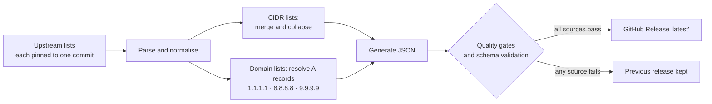

<div align="center">

# Amnezia China Split-Tunnel Lists

**Auto-updating IPv4 split-tunnel lists for [AmneziaVPN](https://amnezia.org): a fixed list of mainland-China networks, and a refreshed list of websites outside China that need the VPN.**

Refreshed every 6 hours by GitHub Actions · Published as GitHub Release assets · No server required

[](https://github.com/shidevil/amnezia-china-split-tunnel/actions/workflows/build.yml)
[](https://github.com/shidevil/amnezia-china-split-tunnel/actions/workflows/ci.yml)
[](https://github.com/shidevil/amnezia-china-split-tunnel/releases/latest)
[](LICENSE)


**English** · [简体中文](README.zh-CN.md)

</div>

---

## Add to Amnezia

Pick **one** of the two lists. They are alternatives, not a pair ([why](#2-import-into-amnezia)).

| If you want… | Download | Amnezia mode |
|---|---|---|
| Mainland-China traffic to stay **outside** the VPN (fixed list, no refreshing needed) | [`cn-cidr.json`](https://github.com/shidevil/amnezia-china-split-tunnel/releases/latest/download/cn-cidr.json) | `Directly` |
| Websites **outside China** that need the VPN (blocked or foreign; refreshed every 6 hours) | [`proxy.json`](https://github.com/shidevil/amnezia-china-split-tunnel/releases/latest/download/proxy.json) | `Via VPN` |

**`proxy.json` must be imported in `Via VPN` mode.** It lists websites outside China, so in `Directly` mode they would skip the VPN, the opposite of what the list is for.

1. **Put the file on the device that runs AmneziaVPN.** Amnezia imports from a local file, not from a link: open the download link in that device's browser, or download it on a computer and send it over.
2. **Disconnect the VPN.** Amnezia does not let you change split tunneling while connected.
3. **Open split tunneling for sites.** On the home screen tap the **Split tunneling** button (it reads "Split tunneling disabled" or "Split tunneling enabled"), then **Site-based split tunneling**.
4. **Choose the mode** with the two-segment switch below the **Split tunneling** toggle: `Directly` for `cn-cidr.json`, `Via VPN` for `proxy.json`.
5. **Import the file.** Tap **⋮** next to the "website or IP" field, choose `Replace site list` (or `Add imported sites to existing ones` to keep entries you added by hand) and select the downloaded `.json` file. Use `Replace site list` every time you refresh a list you imported before.
6. **Switch split tunneling on** with the **Split tunneling** toggle at the top of the page, then connect.


*Screenshot from the [Amnezia documentation](https://docs.amnezia.org/documentation/instructions/vpn-split-tunneling). It shows an older layout of the app: the mode is a drop-down (`Directly` appears there as `Addresses from the list should not be accessed via VPN`, `Via VPN` as `Only the sites listed here will be accessed through the VPN`), and the import choices sit under **Import**. In the current release they are listed directly under **⋮**.*

---

## Table of contents

- [Add to Amnezia](#add-to-amnezia)
- [Overview](#overview)
- [Quick start](#quick-start)
- [Available lists](#available-lists)
- [Output format](#output-format)
- [How it works](#how-it-works)
- [Configuration](#configuration)
- [Automation and releases](#automation-and-releases)
- [Inspecting failures and troubleshooting](#inspecting-failures-and-troubleshooting)
- [Deploy your own copy](#deploy-your-own-copy)
- [Local development](#local-development)
- [Project layout](#project-layout)
- [Limitations: read this before relying on the lists](#limitations-read-this-before-relying-on-the-lists)
- [Acknowledgements](#acknowledgements)
- [License](#license)

## Overview

AmneziaVPN's split tunneling routes **IP addresses and subnets**. It never matches a domain name, and it never refreshes a list by itself (the details are under [Limitations](#limitations-read-this-before-relying-on-the-lists)). A list of domains is therefore only as good as the addresses it was resolved to on the day it was imported.

This project is built around that. It publishes exactly **two kinds of list**, and you import **one** of them:

| | `cn-cidr.json` (fixed) | `proxy.json` (updated) |
|---|---|---|
| **What it is** | IPv4 networks (CIDR), copied from upstream and merged | domains, each with the IPv4 addresses DNS returned for it |
| **Contents** | mainland-China networks, from two upstream lists | websites outside China that need the VPN: the GFW and proxy domain lists of Loyalsoldier |
| **Amnezia mode** | `Directly`: China stays outside the VPN | `Via VPN` only: never import it in `Directly` mode |
| **Goes stale in the app?** | barely: allocations change slowly | yes: DNS answers change, so re-import it from time to time |

Every 6 hours a GitHub Actions workflow:

1. fetches the upstream lists, each pinned to one upstream commit,
2. parses and normalises the rules,
3. **merges** the CIDR lists into the fewest networks covering the same addresses, and **resolves** each domain's IPv4 A records through public DNS resolvers,
4. writes Amnezia-compatible JSON files,
5. validates them against strict quality gates, and
6. publishes them to a single rolling GitHub Release, so the download URLs never change. A list is re-published only when its content changed.

If anything goes wrong while building (a DNS outage, an empty or truncated upstream file, a failed quality gate), the build fails and **the previous release stays untouched**. If the upload itself fails, it is retried and the previous assets are restored (see [Automation and releases](#automation-and-releases)).

### Highlights

- **Fully automated**: scheduled every 6 hours plus manual runs; no local machine or server involved.
- **Two lists, no overlap in purpose**: one fixed list that does not depend on DNS, one refreshed domain list.
- **Suffix rules preserved**: `.example.com` and `example.com` are different rules and stay different in the output.
- **Safe by construction**: all-or-nothing publishing, failure-rate gates, a size floor for every upstream and a size ceiling for the merged network list, schema validation of the written files, and a fail-fast abort when the DNS resolvers are unreachable.
- **Only usable addresses**: IPv4 only; sinkhole answers (`0.0.0.0`, `127.0.0.1`), private ranges and implausibly short prefixes (shorter than `/8`) never reach a routing list.
- **Deterministic output**: stable ordering, so unchanged data produces identical files and no needless release updates.
- **Config-driven**: add, merge or disable a source in `config.yaml`; no code changes.
- **Least privilege**: the build job is read-only; only the publish job can write; all third-party actions are pinned to commit SHAs.

## Quick start

### 1. Download

The rolling release is tagged `latest`. These URLs are stable and need no authentication on a public repository:

| List | Download |
|---|---|
| cn-cidr (fixed) | <https://github.com/shidevil/amnezia-china-split-tunnel/releases/latest/download/cn-cidr.json> |
| proxy (updated) | <https://github.com/shidevil/amnezia-china-split-tunnel/releases/latest/download/proxy.json> |

```bash
curl -fLO https://github.com/shidevil/amnezia-china-split-tunnel/releases/latest/download/cn-cidr.json
```

> **Using a fork?** Replace `shidevil/amnezia-china-split-tunnel` with `<your-account>/<your-repository>` in every URL. The tag-pinned form
> `https://github.com/<owner>/<repo>/releases/download/latest/cn-cidr.json` also works and always points at the tag named `latest`.

### 2. Import into Amnezia

The step-by-step instructions are at the top of this page: [Add to Amnezia](#add-to-amnezia). This section explains which mode fits which list.

Which mode for which list:

| Goal | Amnezia mode | List |
|---|---|---|
| Mainland-China traffic stays **outside** the VPN, everything else uses it | `Directly` | `cn-cidr.json` |
| Websites **outside China** that need the VPN use it, everything else is direct | `Via VPN` | `proxy.json` |

The current app (release 5.1.1.10) shows the two modes as segments called `Via VPN` and `Directly`. Older versions show a drop-down instead: `Directly` is `Addresses from the list should not be accessed via VPN` and `Via VPN` is `Only the sites listed here will be accessed through the VPN`.

**The two files are alternatives, not a pair.** The app has one active mode at a time and keeps a separate site list for each mode, so loading both gains nothing: in `Directly` mode `proxy.json` is ignored, in `Via VPN` mode `cn-cidr.json` is. Which one to start with is your call. `cn-cidr.json` never needs refreshing, but it uses the mode that Amnezia's documentation recommends least (it recommends that mode only for local and ISP networks). `proxy.json` uses the recommended `Via VPN` mode, but goes stale as DNS answers change. Try either one on your device before relying on it (see [Limitations](#limitations-read-this-before-relying-on-the-lists)).

## Available lists

All files carry the [Amnezia import format](#output-format). Upstream files are fetched through `raw.githubusercontent.com` and pinned to the commit current at build time.

| Output | Kind | Upstream files | What it contains |
|---|---|---|---|
| `cn-cidr.json` | `cidr` | [`chnroute.txt`](https://raw.githubusercontent.com/mayaxcn/china-ip-list/master/chnroute.txt) of [mayaxcn/china-ip-list](https://github.com/mayaxcn/china-ip-list), and [`CN.txt`](https://raw.githubusercontent.com/Xiaobei09/Rule-Provider/main/ruleset/geoip/QuantumultX/CN.txt) of [Xiaobei09/Rule-Provider](https://github.com/Xiaobei09/Rule-Provider) | Mainland-China IPv4 networks. A network is kept if **either** upstream lists it (a union), and the result is collapsed. IPv6 lines are dropped. |
| `proxy.json` | `domains` | `gfw.txt` and `proxy.txt` from the `release` branch of [Loyalsoldier/surge-rules](https://github.com/Loyalsoldier/surge-rules/tree/release) | Websites outside China that need the VPN: the domains of both files, merged and de-duplicated, each with its current IPv4 addresses. Import it in `Via VPN` mode only. |
| `build-info.json` | n/a | n/a | Build metadata: timestamp, upstream commits, per-list counts, hashes |

About `proxy.json`: it is not a list of every address outside China. It holds only the websites that the two Loyalsoldier files say need the VPN, and in `Via VPN` mode everything that is not on it goes out directly. In the build of 2026-11-24, 217 of its 21,015 distinct IP addresses (1.0%) fall inside the China networks of `cn-cidr.json`: the upstream files also carry a few China-hosted domains (149 of the 22,485 entries have at least one such address, for example alicloud.com). In `Via VPN` mode those still go through the VPN, which is harmless. In `Directly` mode the whole list would skip the VPN, so never import it there.

About the union: when this was written the two upstream lists agreed on about 96% of the address space, and the union adds the 3.8% (13.6 million addresses) that only one of them claims. 5.8 million of those addresses were added to mayaxcn's list during the previous week and are not in the other list. The union was chosen on purpose: it keeps more mainland-China traffic out of the VPN. The cost is that if either upstream is wrong about one of those ranges, foreign traffic to that range bypasses the VPN. If you would rather keep only what both lists agree on, say so in an issue or point `config.yaml` at one URL.

Other Loyalsoldier lists (`direct`, `reject`, `apple`, …) are no longer built: a domain-to-IP snapshot is a poor fit for the app, and the fixed list covers China. You can still add any of them to `config.yaml` (see [Configuration](#configuration)).

### Typical results

Measured in a full build on 2026-11-24 (upstream commits `6eaf976`, `4f4feb1` and `964903e`; resolvers 1.1.1.1, 8.8.8.8 and 9.9.9.9). It ran in Docker on the developer's machine, **not** on a GitHub runner. Both lists passed every quality gate. DNS answers change all the time, so read these numbers as magnitudes, not promises.

| List | Rules | Entries | Result | Size |
|---|---:|---:|---|---:|
| `cn-cidr.json` | 7,305 | 6,793 | 359,175,656 addresses (8.4% of IPv4) | 486.1 kB |
| `proxy.json` | 27,407 | 22,485 | 82.0% resolved | 3.0 MB |

The CIDR list came from 5,697 and 7,054 upstream IPv4 networks, of which 5,446 are in both files, leaving 7,305 distinct networks that collapse into 6,793 CIDRs. 2,982 IPv6 lines were skipped and none was invalid. In the domain list, 4,346 rules appear in both `gfw.txt` and `proxy.txt`.

Of the 4,922 domain rules without an entry, 4,393 have no A record (1,485 NXDOMAIN, 2,908 empty answers or IPv6 only), 282 got SERVFAIL, 247 timed out and none failed in any other way. Only the timeouts count toward the error gate: 0.90%, against a limit of 10%. The 22,485 entries hold 42,326 addresses, 21,015 of them distinct.

## Output format

Each file is a UTF-8 JSON array in the format Amnezia imports. Both kinds use the same three keys, in the same order.

### Domain entries

`proxy.json` holds one entry per rule that resolved:

```json
[
  {
    "hostname": ".example.com",
    "ip": "93.184.216.34",
    "ips": [
      "93.184.216.34"
    ]
  },
  {
    "hostname": "baidu.com",
    "ip": "110.242.74.102",
    "ips": [
      "110.242.74.102",
      "111.63.65.103",
      "111.63.65.247",
      "124.237.177.164"
    ]
  }
]
```

| Field | Meaning |
|---|---|
| `hostname` | The original rule, **lower-cased, leading dot preserved** |
| `ip` | The first address of `ips` |
| `ips` | All unique public IPv4 addresses, sorted numerically |

Entries are sorted by domain name (a leading dot is ignored when sorting), so unchanged DNS data yields byte-identical files.

### Suffix rules

The Loyalsoldier files contain two kinds of rules, and they are **not the same thing**:

| Rule | Meaning | Resolved name | `hostname` in the output |
|---|---|---|---|
| `example.com` | exactly this host | `example.com` | `example.com` |
| `.example.com` | this domain **and every subdomain** (suffix match) | `example.com` | `.example.com` |

For a suffix rule the apex name (`example.com`) is resolved, but the leading dot is kept in `hostname`. The generator **never guesses subdomains** and never invents IP addresses; it only reports what DNS actually returned for the name in the rule.

Domains with no usable IPv4 record are **left out**, not written with an empty `ips`; they are listed in the failure report instead.

### CIDR entries

`cn-cidr.json` holds one entry per network, in the shape the Amnezia client itself exports for a subnet that was added by hand: the network is the `hostname`, and `ip` and `ips` are empty.

```json
[
  {
    "hostname": "1.0.1.0/24",
    "ip": "",
    "ips": []
  },
  {
    "hostname": "1.0.8.0/21",
    "ip": "",
    "ips": []
  }
]
```

Entries are sorted by address, adjacent networks are combined (`1.0.0.0/24` and `1.0.1.0/24` become `1.0.0.0/23`) and networks contained in another are dropped, so the file is the smallest set of CIDRs covering exactly the addresses the upstream lists name. Nothing is resolved: what you import is what is routed.

## How it works



1. **Fetch.** For every URL on GitHub, the branch is resolved to a commit SHA first and the file is downloaded at that SHA, so the `revision` recorded in `build-info.json` describes exactly what was read. (If the GitHub API lookup fails, the branch URL is used instead and `revision` is `null`.) Downloads are retried with backoff; empty, oversized, truncated (shorter than the declared `Content-Length`) or non-UTF-8 responses are rejected.
2. **Parse.** Comments and blank lines are skipped and exact duplicates are dropped. Invalid lines are reported rather than silently ignored. **Every URL of a source must contribute rules**: one that serves only junk stops the build instead of silently dropping out of a merged list.
   - *Domain lists:* rules are lower-cased and validated; IP literals, wildcards, IDN and malformed labels are invalid.
   - *CIDR lists:* the three spellings seen upstream are accepted (`1.0.1.0/24`, `ip-cidr, 1.0.1.0/24` and `IP-CIDR,1.0.1.0/24,DIRECT,no-resolve`). IPv6 lines (including the QuantumultX `ip6-cidr` keyword) are skipped on purpose and counted. Invalid lines: host bits set, a prefix shorter than `/8`, any overlap with a private or special-purpose range, and any line that names a policy other than `DIRECT`. A listed network bypasses the VPN, so `IP-CIDR,8.8.8.0/24,PROXY` must not end up on the list, and a list containing `0.0.0.0/0` would route everything around the VPN.
3. **Resolve (domain lists only).** All distinct names across all domain sources are resolved **once** (see [DNS resolution](#dns-resolution)). CIDR lists never touch DNS.
4. **Generate and validate.** JSON is built deterministically, then checked twice: before writing, and again on the written files.
5. **Decide.** Lists whose content hash is unchanged since the last release are not re-uploaded (unless forced).
6. **Publish.** A separate job with write permission uploads the files and verifies them.

### DNS resolution

This applies to domain lists only.

- IPv4 **A records only**; no AAAA.
- The starting resolver is chosen from a stable hash of the name (load is spread across resolvers and runs are reproducible); each retry moves to the next resolver.
- **Answers that end a lookup:** an address list, `NXDOMAIN`, or an empty answer (`NODATA`). Everything else (timeout, `SERVFAIL`, `REFUSED`, network error) is retried, up to `retries` extra attempts.
- **CNAME chains are followed** inside the answer: `www.shop.example → edge.cdn.example → pop7.cdn.example → A` yields the final A records.
- Addresses that are not public unicast IPv4 (`0.0.0.0/8`, `10/8`, `100.64/10`, `127/8`, `169.254/16`, `172.16/12`, `192.168/16`, `198.18/15`, multicast, reserved, documentation ranges, …) are dropped. The range table is explicit, so results do not depend on the Python version.
- Concurrency is bounded (a fixed pool of workers) and a global queries-per-second cap protects the public resolvers.
- The same name is never queried twice in a build, even when it appears in several rules or lists.
- No cross-build DNS cache: record TTLs are far shorter than the 6-hour refresh interval, so a cache would almost never hit and could only serve stale data.

Each rule ends in exactly one outcome:

| Outcome | Meaning | Counts toward the error gate |
|---|---|---|
| `ok` | at least one public IPv4 address | no |
| `nxdomain` | the name does not exist | no |
| `nodata` | the name exists but has no (public) A record | no |
| `servfail` | every attempt got SERVFAIL (usually a broken zone) | no |
| `timeout` | no answer from any resolver | **yes** |
| `error` | network error, REFUSED (a resolver refusing to serve us) or any other unexpected response | **yes** |

### Quality gates

Per source, a build fails if any of these is violated. The gates differ by kind, and options of the other kind are rejected in `config.yaml`.

**Domain lists:**

| Gate | Default | Purpose |
|---|---|---|
| `max_error_rate` | `0.10` | `(timeouts + errors) / rules`: detects a resolver or network outage |
| `min_resolved_rate` | `0.30` | `resolved / rules`: detects "every answer was empty" outages |
| `allow_empty` | `false` | a source that resolves to **zero** entries is rejected |
| JSON schema | always | exact keys, `ip == ips[0]`, unique, sorted, public IPv4, valid unique hostnames |

NXDOMAIN, empty answers and SERVFAIL describe the *domain*, not the resolver, so they deliberately do not count toward the error gate.

**CIDR lists:**

| Gate | Default | Purpose |
|---|---|---|
| `min_entries` | `1` (shipped: `4000`) | **every URL**, and the merged list, must hold at least this many valid networks, so a truncated or broken feed cannot silently drop out of the union |
| `max_addresses` | none (shipped: `400000000`) | refuse a list covering more addresses than this: a feed that claims too much is the dangerous failure of a list that bypasses the VPN |
| JSON schema | always | exact keys, empty `ip` and `ips`, canonical public IPv4 networks, no prefix shorter than `/8`, sorted, no overlaps |

Publishing is **all-or-nothing**: if any selected source fails, nothing is uploaded and the previous release remains. Thresholds can be overridden per source (see below).

**Fail-fast on outages.** If, after at least 500 lookups, more than 90% of them timed out or errored, no resolver is answering from the runner. The build stops at once (exit code 1, nothing published) instead of spending hours retrying every remaining name. A merely degraded network (throttling, clusters of dead domains) is not aborted; the per-source error-rate gate decides that after the run.

## Configuration

Everything lives in [`config.yaml`](config.yaml).

### Enable or disable a source

```yaml
sources:
  proxy:
    enabled: false        # skip this list
    url:
      - https://raw.githubusercontent.com/Loyalsoldier/surge-rules/release/gfw.txt
      - https://raw.githubusercontent.com/Loyalsoldier/surge-rules/release/proxy.txt
```

Disabling a source stops updating it. It drops out of `build-info.json` the next time a build publishes (disabling alone changes no list, so it does not trigger a publish; run the workflow with `force` to apply it immediately), but its old asset stays on the release until you delete it yourself (for example `gh release delete-asset latest proxy.json`). The same applies to a source you remove from the file.

### Add a source

Add an entry; no code changes are needed. The key becomes the output file name (`my-list` → `my-list.json`) and may contain `a-z`, `0-9`, `_` and `-`. The names `build-info` and `all` are reserved.

```yaml
sources:
  my-domains:
    url: https://example.com/path/to/domains.txt   # plain or ".suffix" rules, one per line
    min_resolved_rate: 0.2                         # optional per-source overrides

  my-networks:
    kind: cidr                                     # IPv4 networks instead of domains
    url:                                           # several URLs are merged into one list
      - https://example.com/a/chnroute.txt
      - https://example.com/b/CN.txt
    min_entries: 1000                              # each URL and the merged list
    max_addresses: 500000000                       # optional ceiling
```

- `kind` is `domains` (the default) or `cidr`. `max_error_rate`, `min_resolved_rate` and `allow_empty` belong to `domains`, `min_entries` and `max_addresses` to `cidr`; the loader rejects the wrong combination.
- `url` is one URL or a list. Use the `raw.githubusercontent.com` address of a file, not its `github.com/…/blob/…` page: the page is HTML, and only a raw address can be pinned to a commit.
- A domain list is read in the Surge domain-set format used by Loyalsoldier: one `host` or `.suffix` per line, with `#`, `;` or `//` comment lines allowed. A CIDR list accepts the three spellings described under [How it works](#how-it-works).
- To bring back another Loyalsoldier list, add it as a domain source with its URL, for example `.../release/direct.txt`. Mind the size: see [Limitations](#limitations-read-this-before-relying-on-the-lists).

> **YAML gotcha:** unquoted `off`, `on`, `yes`, `no` and plain numbers are not strings in YAML 1.1. Quote such names (`"off":`); the loader rejects them with a clear error otherwise.

### DNS, fetching and thresholds

```yaml
dns:
  resolvers: [1.1.1.1, 8.8.8.8, 9.9.9.9]   # any number of resolver IPs
  timeout: 5          # seconds per attempt
  retries: 2          # extra attempts after the first, each on the next resolver
  concurrency: 100    # lookups in flight at once
  max_qps: 300        # global query-rate cap (0 = unlimited)

fetch:
  timeout: 30
  retries: 3
  max_bytes: 67108864

validation:           # defaults for every domain source
  max_error_rate: 0.10
  min_resolved_rate: 0.30
  allow_empty: false
```

Unknown keys are rejected, so a typo such as `enabeld: false` can never silently leave a source enabled.

## Automation and releases

| | |
|---|---|
| **Schedule** | `0 */6 * * *` (00:00, 06:00, 12:00, 18:00 **UTC**). GitHub may delay scheduled runs under load; treat 6 hours as a refresh interval, not a guarantee. |
| **Manual run** | *Actions → Build Amnezia lists → Run workflow* |
| **Manual inputs** | `source`: `all` or a comma-separated list such as `cn-cidr,proxy` (a single-source build needs an existing release, so run a full build first); `force`: publish even if nothing changed |
| **Release** | One rolling release, tag `latest`. Assets are replaced in place on every successful build, and only when their content changed. |
| **Runtime** | Resolving the 27,402 distinct names of `proxy.json` took about 6 minutes (about 76 names/s) in the build above; the whole run took 6 min 14 s. This was **not** measured on a GitHub-hosted runner. The `max_qps: 300` cap puts a floor of about 1.5 minutes under it, and the job limit is 4 hours. A build of `cn-cidr` alone does no DNS at all. |

The workflow has three jobs:

| Job | Permission | Role |
|---|---|---|
| `build` | `contents: read` | fetch, resolve, generate, validate; uploads the result as a workflow artifact |
| `publish` | `contents: write` | runs only if `build` produced changes; backs up the current assets, uploads the lists and then `build-info.json` (with retries), restores the backup if every attempt fails, then verifies sizes |
| `keepalive` | `actions: write` | best-effort re-enable of the schedule (see below); can never fail a run |

Every run writes a summary (per-list counts, failures) to the job summary page, and uploads `reports/` (failure lists) as a build artifact.

**If a publish fails.** The publish job first backs up the current assets (and stops if that fails). It then uploads the changed lists and only afterwards `build-info.json`, retrying up to three times. Because the previous `build-info.json` stays in place until every list has arrived, a run that dies half-way cannot make the next run believe stale lists are current. If all attempts fail, the assets this run replaced are restored from the backup (also with retries) and the run is marked failed; assets the run never touched are left alone. `gh release upload --clobber` deletes an asset before uploading its replacement, so a download that happens during that window can briefly find a file missing or old; if the restore also fails, the run says so loudly and the next successful build republishes the affected lists (their content hash will differ from the old `build-info.json`; if a list happens to be identical to the old one, run the workflow with `force`).

**Single-source and unchanged builds.** A manual run with `source=proxy` rebuilds only `proxy.json` and merges its record into the existing `build-info.json`, so the other lists and their metadata stay as they were. Lists whose generated content is byte-identical to the previous release are not re-uploaded; for `cn-cidr.json` that is most runs.

**Scheduled workflows can be switched off by GitHub.** In public repositories GitHub disables scheduled workflows after 60 days without repository activity. Because this project never commits to the repository, the `keepalive` job re-enables the workflow on every scheduled run. This is a best-effort measure whose effect on GitHub's inactivity timer is not guaranteed; if the schedule is ever disabled, any push or a manual run revives it.

### `build-info.json`

```json
{
  "generator_version": "1.0.0",
  "generated_at": "2026-11-24T06:00:00Z",
  "upstream": [{"repository": "mayaxcn/china-ip-list", "branch": "master", "revision": "<commit sha>"}],
  "dns": {"resolvers": ["1.1.1.1", "8.8.8.8", "9.9.9.9"], "unique_queries": 27402},
  "totals": {"domains_processed": 0, "domains_resolved": 0, "domains_failed": 0, "...": 0},
  "sources": {
    "cn-cidr": {
      "file": "cn-cidr.json", "kind": "cidr", "entries": 0, "addresses": 0, "output_sha256": "...",
      "upstreams": [{"url": "...", "revision": "<commit sha>", "sha256": "...", "rules": 0}],
      "...": 0
    }
  }
}
```

`totals` describe the domain lists only: networks are not "domains processed". `dns.unique_queries` counts the distinct names resolved in *this* run. After a single-source build it therefore describes that run only, while the other sources keep their earlier records.

## Inspecting failures and troubleshooting

**Failure reports.** Every build writes `reports/<source>-failures.txt` for each domain list, one line per rule that did not produce an entry. (CIDR lists have no failure report: nothing is resolved. Lines that were refused, such as a private range, are logged by the build: the first five per source, then a count.)

```text
# proxy: 22485 of 27407 rules resolved to a public IPv4 address
# nxdomain=... nodata=... servfail=... timeout=... error=... invalid-lines=...
# columns: status<TAB>rule<TAB>detail
timeout	.slow.example.cn	timeout from 8.8.8.8
nxdomain	.gone.example	
```

Download them from the run page: *Actions → the run → Artifacts → `build-reports`*.

| Symptom | Likely cause and fix |
|---|---|
| Build fails with `error rate … exceeds the … limit` | Resolvers were unreachable or throttling. Re-run; if it persists, lower `dns.concurrency` / `dns.max_qps`, raise `dns.timeout` / `dns.retries`, or change `dns.resolvers`. |
| `resolved rate … is below the … minimum` | Almost every answer was empty. Check the resolvers and `reports/*-failures.txt`; for lists that legitimately resolve poorly set a per-source `min_resolved_rate`. |
| `resolvers unreachable: … lookups timed out or failed` | The runner could not reach any of the configured resolvers, so the build stopped early. Nothing was published. Re-run later, or point `dns.resolvers` at resolvers that are reachable from GitHub's network. |
| `… has only N valid IPv4 CIDRs (minimum M)` | That upstream was empty, truncated or changed its format, and was not allowed to drop out of the union. Open the URL named in the message. If the feed really shrank, lower `min_entries`. |
| `only N merged CIDRs (minimum M)` | The merged list is too small even though each upstream passed. Check the upstream diffs before lowering `min_entries`. |
| `entry …: prefix is shorter than /8` | Two adjacent upstream networks (for example `6.0.0.0/8` and `7.0.0.0/8`) collapsed into a block larger than this tool will route around the VPN. The build fails and keeps the previous release; look at the upstream diff before changing anything. |
| `the list covers … addresses, over the … limit` | An upstream list grew far beyond mainland China's real size, or a wrong range slipped in. Inspect the upstream diff before raising `max_addresses`. |
| `source '…': … has no valid IPv4 CIDRs` | The URL did not serve a CIDR list (an HTML page, for example a `github.com/…/blob/…` link). Use the raw address. |
| `no usable previous build-info.json to merge into` | A manual single-source run merges into the existing release's `build-info.json`, and it was missing, corrupt or could not be downloaded. Run the workflow once with `source=all` (or re-run if the download failed). |
| `no domains resolved … refusing to publish empty output` | Zero entries. Set `allow_empty: true` for that source only if an empty file is genuinely expected (for example a list of bare top-level domains). |
| `source '…' has no valid rules` | The upstream domain file was empty or in another format. Open the URL in the config and check it. |
| `GET … failed` | Network or upstream problem; the fetcher already retried. Re-run later. |
| A domain you expect is missing | Look it up in `<source>-failures.txt`. `nodata` usually means the name has no A record of its own (common for suffix rules on apex-less zones and TLDs). |
| Many `servfail` entries | Normal for dead or lame domains in large lists; they do not trip the error gate. |
| The scheduled run stopped appearing | See the 60-day note above; trigger *Run workflow* once. |

To test a resolver by hand: `dig @1.1.1.1 +short A example.com`.

## Deploy your own copy

**Prerequisites:** a GitHub account and `git`. No server, API key or secret is needed.

1. **Create** an empty repository (public is simplest, because anonymous download links and unlimited Actions minutes need a public repository).
2. **Push** this project (the commands use this project's repository; use yours when you fork):

   ```bash
   git init
   git add -A
   git commit -m "Initial commit"
   git remote add origin git@github.com:shidevil/amnezia-china-split-tunnel.git
   git branch -M main
   git push -u origin main
   ```

3. **Enable Actions.** Open the *Actions* tab; if GitHub asks, click *"I understand my workflows, go ahead and enable them"* (forks start with workflows disabled).
4. **Check the token permissions.** The workflows declare their own permissions, so the default setting is fine. If your organisation enforces a read-only cap, set *Settings → Actions → General → Workflow permissions → Read and write permissions*.
5. **Run it once.** *Actions → Build Amnezia lists → Run workflow* (leave the defaults). This creates the `latest` release; scheduled runs take over from there. Scheduled runs only fire from the default branch.
6. **Use the links** from [Quick start](#quick-start), after replacing the owner and repository name.

## Local development

```bash
python3.12 -m venv .venv && source .venv/bin/activate
pip install -r requirements-dev.txt

pytest                     # unit and end-to-end tests (fake DNS, no network)
ruff check . && ruff format --check .
RUN_LIVE_DNS=1 pytest tests/test_live_integration.py   # optional: real DNS

python -m src.main --help
python -m src.main --source cn-cidr --out-dir dist --reports-dir reports   # real build of the fixed list (no DNS)
```

CLI options: `--config`, `--source` (`all` or comma-separated), `--force`, `--out-dir`, `--reports-dir`, `--previous-build-info`, `--require-previous` (fail unless that file is usable; the workflow sets it for single-source builds), `-v`.
Exit codes: `0` success (including "nothing changed"), `1` quality gate or validation failed, `2` configuration, download or parsing problem, `130` interrupted. Nothing is written to `--out-dir` on failure.

A source `url` may also be a `file://` URL, which is how the test-suite builds from local fixtures.

## Project layout

```text
.
├── .github/workflows/
│   ├── build.yml         # schedule + manual: build, publish, keepalive
│   └── ci.yml            # lint + tests on push / pull request
├── config.yaml           # sources, DNS settings, quality gates
├── src/
│   ├── config.py         # load and strictly validate config.yaml
│   ├── fetcher.py        # HTTP with retries, upstream commit pinning
│   ├── parser.py         # domain-set and CIDR list parsing, validation
│   ├── resolver.py       # async A-record resolution (dnspython)
│   ├── generator.py      # entries, CIDR merging, statistics, deterministic JSON
│   ├── validator.py      # schema and quality-gate checks
│   ├── reporter.py       # failure reports, build-info, release notes, summary
│   └── main.py           # orchestration and CLI
├── tests/                # unit, end-to-end and workflow-guard tests
├── reports/              # build reports (generated, not committed)
├── requirements.txt      # dnspython, PyYAML
└── requirements-dev.txt  # + pytest, ruff
```

## Limitations: read this before relying on the lists

### What the Amnezia client does with these files

Read from the client's source code ([amnezia-client](https://github.com/amnezia-vpn/amnezia-client), 5.x) and its [split-tunneling documentation](https://docs.amnezia.org/documentation/instructions/vpn-split-tunneling).

- **Only IP addresses and subnets are routed.** A hostname is never matched against traffic. For a domain entry, only the addresses stored in `ips` count; for a CIDR entry, the network itself.
- **Importing resolves nothing and reads the file once.** No way to subscribe to a URL was found, so refreshing a list means importing a new file by hand. The documentation says the same about domains: the app stores the addresses it has, and does not update them automatically.
- **The desktop client re-resolves saved hostnames on every connect**, and only adds addresses: old ones are never removed. No equivalent was found in the mobile clients, and nothing refreshes while a connection is up. Whether an entry that starts with a dot (a suffix rule) is re-resolved is not known.
- **One mode is active at a time**, each with its own saved list (see [Quick start](#quick-start)).
- **Every address and subnet becomes a route.** `cn-cidr.json` has 6,793 entries, and it imported without problems in the developer's own test. How many routes other clients and operating systems cope with is not known, so try it on your device before relying on it.

### The updated list (`proxy.json`)

This file is an **IP snapshot of DNS answers**, not a live domain-matching system.

- **Geography and resolver dependence.** A domain can resolve to different addresses depending on the resolver, the location it is queried from, and the time. The list reflects what the GitHub runner saw through the configured public resolvers.
- **CDN addresses are shared.** An IP that serves one site today may serve unrelated sites too; routing by IP can catch (or miss) other services.
- **Suffix rules are only approximated.** `.example.com` means "the domain and all subdomains", but only the apex `example.com` is resolved. Subdomains on different IPs are **not** discovered, and the generator does not guess them.
- **DNS changes between builds, and the app does not follow.** The 6-hour schedule is a refresh interval, not a promise that changes show up immediately, and a changed file only helps once you import it.
- **Some domains have no A record.** NXDOMAIN, empty answers and IPv6-only hosts are left out. Bare top-level-domain rules cannot be expressed as IPs at all.
- **Large lists.** If you add one of the big Loyalsoldier lists (`reject` has about 200,000 rules, `direct` about 110,000), the file gets very large and the client may be slow with it or unable to import it.
- **IDN and non-DNS rules.** Non-ASCII names, wildcards and IP literals are reported as invalid lines and skipped (none exist in the current Loyalsoldier lists).
- **Resolver blocking.** If a public resolver throttles a shared GitHub runner IP, a build may fail the error gate. That is intentional: it keeps the previous release instead of publishing an incomplete one. The fail-fast abort only catches a network that is down from the start; if the resolvers go silent part-way through a run, the run is not cut short. It finishes (or reaches the 4-hour job limit) and then fails without publishing, so the cost is wasted runner time, never a bad release.

## Acknowledgements

This project stands on the shoulders of excellent open-source work. Sincere thanks to:

- [**mayaxcn/china-ip-list**](https://github.com/mayaxcn/china-ip-list): the hourly-updated mainland-China IPv4 list that is one half of `cn-cidr.json`.
- [**Xiaobei09/Rule-Provider**](https://github.com/Xiaobei09/Rule-Provider): the QuantumultX `CN.txt` list that is the other half.
- [**APNIC**](https://www.apnic.net/): the public registry data both lists are derived from.
- [**Loyalsoldier/surge-rules**](https://github.com/Loyalsoldier/surge-rules): the maintained domain sets behind `proxy.json`. Everything about the domain list exists because of their rules.
- [**Loyalsoldier/v2ray-rules-dat**](https://github.com/Loyalsoldier/v2ray-rules-dat) and [**v2fly/domain-list-community**](https://github.com/v2fly/domain-list-community): per the surge-rules README, the main data sources of its rule sets.
- [**felixonmars/dnsmasq-china-list**](https://github.com/felixonmars/dnsmasq-china-list): per the surge-rules README, the origin of some domains in the Apple and Google lists.
- [**17mon/china_ip_list**](https://github.com/17mon/china_ip_list): the mainland-China IPv4 data used by surge-rules for its IP rule sets.
- [**Loyalsoldier/geoip**](https://github.com/Loyalsoldier/geoip): credited in the surge-rules acknowledgements.

The last two feed surge-rules' IP-based rule sets rather than the lists this project converts, and they are credited here because the upstream project credits them.

Thanks also to the [AmneziaVPN](https://github.com/amnezia-vpn) team, and to the authors of [dnspython](https://github.com/rthalley/dnspython) and [PyYAML](https://github.com/yaml/pyyaml).

## License

The source code in this repository is released under the [MIT License](LICENSE).

The generated lists are derived from other projects' data. `cn-cidr.json` derives from [mayaxcn/china-ip-list](https://github.com/mayaxcn/china-ip-list) and [Xiaobei09/Rule-Provider](https://github.com/Xiaobei09/Rule-Provider) (both MIT-licensed, built on public APNIC registry data, the second also on IPtoASN data). `proxy.json` derives from [Loyalsoldier/surge-rules](https://github.com/Loyalsoldier/surge-rules), which is licensed under the **GPL-3.0**, and from the projects it builds on. If you redistribute the generated files, please review the upstream licences.
