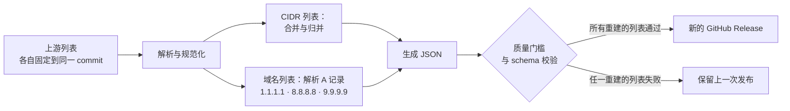

<div align="center">

# Amnezia 中国大陆分流列表

**自动更新的 [AmneziaVPN](https://amnezia.org) IPv4 分流列表：一份固定的中国大陆网段列表，一份持续刷新的“中国大陆以外需要走 VPN 的网站”列表。**

由 GitHub Actions 每 6 小时刷新（UTC 00:41、06:41、12:41、18:41）· 以 GitHub Release 资产发布 · 无需自建服务器

[](https://github.com/shidevil/amnezia-china-split-tunnel/actions/workflows/build.yml)
[](https://github.com/shidevil/amnezia-china-split-tunnel/actions/workflows/ci.yml)
[](https://github.com/shidevil/amnezia-china-split-tunnel/releases/latest)
[](LICENSE)


[English](README.md) · **简体中文**

</div>

---

## 添加到 Amnezia

请从两个列表中**任选一个**。它们是二选一，而不是一对（[原因](#2-导入-amnezia)）。

| 你想要… | 下载 | Amnezia 模式 |
|---|---|---|
| 中国大陆流量留在 VPN **之外**（固定列表，无需刷新） | [`cn-cidr.json`](https://github.com/shidevil/amnezia-china-split-tunnel/releases/latest/download/cn-cidr.json) | `Directly` |
| **中国大陆以外**需要走 VPN 的网站（被封锁或境外站点；每 6 小时刷新） | [`proxy.json`](https://github.com/shidevil/amnezia-china-split-tunnel/releases/latest/download/proxy.json) | `Via VPN` |

**`proxy.json` 必须导入 `Via VPN` 模式。** 它列出的是中国大陆以外的网站，如果导入 `Directly` 模式，这些网站会绕过 VPN，与这份列表的用途正好相反。

1. **把文件放到运行 AmneziaVPN 的设备上。** Amnezia 从本地文件导入，而不是从链接导入：在该设备的浏览器中打开下载链接，或先在电脑上下载再发送过去。
2. **先断开 VPN。** 连接状态下，Amnezia 不允许修改分流设置。
3. **打开站点分流。** 在主屏幕点击 **Split tunneling** 按钮（显示为“Split tunneling disabled”或“Split tunneling enabled”），再点 **Site-based split tunneling**。
4. **选择模式。** 使用 **Split tunneling** 开关下方的两段式切换：`cn-cidr.json` 选 `Directly`，`proxy.json` 选 `Via VPN`。
5. **导入文件。** 点击“website or IP”输入框旁边的 **⋮**，选 `Replace site list`（如果想保留你手动添加的条目，选 `Add imported sites to existing ones`），再选择下载的 `.json` 文件。每次刷新之前导入过的列表时，请选 `Replace site list`。
6. **打开分流开关：** 页面顶部的 **Split tunneling** 开关，然后连接 VPN。


*截图来自 [Amnezia 官方文档](https://docs.amnezia.org/documentation/instructions/vpn-split-tunneling)。它展示的是 App 的旧版布局：模式是下拉菜单（`Directly` 在其中显示为 `Addresses from the list should not be accessed via VPN`，`Via VPN` 显示为 `Only the sites listed here will be accessed through the VPN`），导入选项位于 **Import** 之下。在当前版本中，这些选项直接列在 **⋮** 菜单中。*

---

## 目录

- [添加到 Amnezia](#添加到-amnezia)
- [项目简介](#项目简介)
- [快速开始](#快速开始)
- [可用列表](#可用列表)
- [输出格式](#输出格式)
- [工作原理](#工作原理)
- [配置](#配置)
- [自动化与发布](#自动化与发布)
- [查看失败报告与故障排查](#查看失败报告与故障排查)
- [部署你自己的副本](#部署你自己的副本)
- [本地开发](#本地开发)
- [项目结构](#项目结构)
- [局限性：使用前请先阅读](#局限性使用前请先阅读)
- [我们测试过的其他数据源](#我们测试过的其他数据源)
- [致谢](#致谢)
- [许可证](#许可证)

## 项目简介

AmneziaVPN 的分流功能路由的是 **IP 地址和子网**。它从不按域名匹配，也不会自行刷新列表（细节见[局限性](#局限性使用前请先阅读)）。因此，一份域名列表的质量，最多只相当于导入当天解析出的地址。

本项目正是围绕这一点设计的。它只发布**两种列表**，而你只需导入其中**一个**：

| | `cn-cidr.json`（固定） | `proxy.json`（持续更新） |
|---|---|---|
| **是什么** | IPv4 网段（CIDR），取自上游并合并 | 域名，以及 DNS 为每个域名返回的 IPv4 地址 |
| **内容** | 中国大陆网段，来自两份上游列表 | 中国大陆以外需要走 VPN 的网站：Loyalsoldier 的 GFW 与 proxy 域名列表 |
| **Amnezia 模式** | `Directly`：中国大陆流量留在 VPN 之外 | 只能用 `Via VPN`：绝不要导入 `Directly` 模式 |
| **在 App 内会过期吗？** | 几乎不会：地址分配变化很慢 | 会：DNS 应答会变，需要时不时重新导入 |

GitHub Actions 工作流每 6 小时（UTC 00:41、06:41、12:41、18:41，即北京时间 08:41、14:41、20:41、02:41）执行一次：

1. 拉取上游列表，每个都固定到同一个上游 commit，
2. 解析并规范化规则，
3. 把 CIDR 列表**合并**为覆盖相同地址的最少网段，并通过公共 DNS 解析器**解析**每个域名的 IPv4 A 记录，
4. 生成 Amnezia 兼容的 JSON 文件，
5. 按严格的质量门槛进行校验，
6. 只要有列表发生变化，就发布一个新的 GitHub Release。最新的发布始终是标记为 *Latest* 的那一个，因此下载链接永不改变。内容没有变化的列表会沿用上一个发布中的版本。

如果构建过程中出现问题（DNS 故障、上游文件被截断、质量门槛未通过），构建就会失败，**上一次的发布保持不变**。上游无法下载或不含任何可用规则是例外：只有它自己的列表会暂停，并沿用旧文件。如果在新发布公开之前出现任何失败，该发布会被删除（它以草稿形式创建，无人可见），因此用户下载的仍是上一个发布（见[自动化与发布](#自动化与发布)）。

### 特性

- **全自动**：每 6 小时构建一次，也可手动触发；构建在 GitHub Actions 上运行，不依赖你自己的机器。
- **两份列表，用途不重叠**：一份不依赖 DNS 的固定列表，一份持续刷新的域名列表。
- **保留后缀规则**：`.example.com` 与 `example.com` 是不同的规则，输出中也保持区分。
- **设计上安全**：质量门槛全部通过才发布（失败率、每个上游的数量下限与合并后网段的规模上限）、对写出的文件做 schema 校验、在 DNS 解析器不可达时快速中止；上游损坏的列表则沿用上一次发布的文件。
- **只保留可用地址**：仅 IPv4；黑洞应答（`0.0.0.0`、`127.0.0.1`）、私有网段和短得离谱的前缀（短于 `/8`）都不会进入路由列表。
- **输出确定**：顺序稳定，数据未变化时生成完全相同的文件，不会产生无意义的 Release 更新。
- **配置驱动**：在 `config.yaml` 中新增、合并或停用数据源，无需改代码。
- **最小权限**：构建任务只读；只有发布任务可写；所有第三方 Action 都固定到 commit SHA。

## 快速开始

### 1. 下载

每个发布都以其构建时间作为标签（例如 `2026-11-24-070000`），最新的一个标记为 *Latest*。以下链接始终指向最新发布，稳定不变，公开仓库无需认证：

| 列表 | 下载地址 |
|---|---|
| cn-cidr（固定） | <https://github.com/shidevil/amnezia-china-split-tunnel/releases/latest/download/cn-cidr.json> |
| proxy（持续更新） | <https://github.com/shidevil/amnezia-china-split-tunnel/releases/latest/download/proxy.json> |

```bash
curl -fLO https://github.com/shidevil/amnezia-china-split-tunnel/releases/latest/download/cn-cidr.json
```

> **使用 fork？** 请把所有链接中的 `shidevil/amnezia-china-split-tunnel` 替换为 `<你的账号>/<你的仓库>`。如需固定到某一次构建，请使用它的标签：
> `https://github.com/<owner>/<repo>/releases/download/<tag>/cn-cidr.json`。标签对应的发布被清理后，该链接即失效。

### 2. 导入 Amnezia

具体的分步操作见本页顶部的[添加到 Amnezia](#添加到-amnezia)。本节说明哪种模式适合哪个列表。

不同列表对应的模式：

| 目标 | Amnezia 模式 | 列表 |
|---|---|---|
| 中国大陆流量留在 VPN **之外**，其余流量走 VPN | `Directly` | `cn-cidr.json` |
| 中国大陆**以外**需要走 VPN 的网站走 VPN，其余全部直连 | `Via VPN` | `proxy.json` |

当前版本的 App（5.1.1.10）把这两种模式显示为名为 `Via VPN` 和 `Directly` 的两个分段按钮。旧版本显示的是下拉菜单：`Directly` 对应 `Addresses from the list should not be accessed via VPN`，`Via VPN` 对应 `Only the sites listed here will be accessed through the VPN`。

**这两个文件是二选一，而不是一对。** App 同一时间只有一种模式生效，并且每种模式各自保存一份站点列表，所以两个都导入没有意义：在 `Directly` 模式下 `proxy.json` 会被忽略，在 `Via VPN` 模式下 `cn-cidr.json` 会被忽略。先用哪一个由你决定。`cn-cidr.json` 永远不需要刷新，但它使用的是 Amnezia 文档最不推荐的模式（文档只推荐把该模式用于本地和运营商网络）。`proxy.json` 使用的是推荐的 `Via VPN` 模式，但会随着 DNS 应答的变化而过期。在依赖其中任何一个之前，请先在你的设备上试一试（见[局限性](#局限性使用前请先阅读)）。

## 可用列表

所有文件都使用 [Amnezia 导入格式](#输出格式)。上游文件通过 `raw.githubusercontent.com` 获取，并固定到构建时的当前 commit。

| 输出文件 | 类型 | 上游文件 | 内容 |
|---|---|---|---|
| `cn-cidr.json` | `cidr` | [mayaxcn/china-ip-list](https://github.com/mayaxcn/china-ip-list) 的 [`chnroute.txt`](https://raw.githubusercontent.com/mayaxcn/china-ip-list/master/chnroute.txt)，以及 [gaoyifan/china-operator-ip](https://github.com/gaoyifan/china-operator-ip) 的 [`china.txt`](https://raw.githubusercontent.com/gaoyifan/china-operator-ip/ip-lists/china.txt) | 中国大陆 IPv4 网段。只要**任意一份**上游列出某个网段就保留（并集），然后合并。IPv6 行会被丢弃。 |
| `proxy.json` | `domains` | [Loyalsoldier/surge-rules](https://github.com/Loyalsoldier/surge-rules/tree/release) `release` 分支的 `gfw.txt` 与 `proxy.txt` | 中国大陆以外需要走 VPN 的网站：两份文件中的域名，合并并去重，每个域名附带其当前的 IPv4 地址。只能导入 `Via VPN` 模式。 |
| `build-info.json` | 无 | 无 | 构建元数据：时间戳、上游 commit、各列表统计与哈希 |

关于 `proxy.json`：它不是“中国大陆以外所有地址”的列表，只包含 Loyalsoldier 的两份文件认为需要走 VPN 的网站；在 `Via VPN` 模式下，不在列表里的一切都直连。在 2026-11-24 的构建中，它的 21,015 个不同 IP 地址里有 217 个（1.0%）落在 `cn-cidr.json` 的中国大陆网段内：上游文件里也有少量托管在国内的域名（22,485 个条目中有 149 个至少含一个这样的地址，例如 alicloud.com）。在 `Via VPN` 模式下，这些地址依然走 VPN，并无害处。在 `Directly` 模式下，整份列表都会绕过 VPN，所以绝不要在那里导入。

关于并集：只要**任意一份**上游列出某个网段，`cn-cidr.json` 就会保留它，所以任何一份中的错误网段都会让对应流量绕过 VPN。两者的构建方式不同：mayaxcn 基于 APNIC 注册记录；gaoyifan 基于经由中国主要运营商的 BGP 路由数据，再加上登记在中国、但没有任何网络宣告的地址。2026-11-26 两者在 97.9% 的地址空间上一致，并集为 5,801 个 CIDR、351,463,272 个地址，其中只有 80,896 个是 mayaxcn 没有的。因此第二份列表只是小幅补充，**并不是备份**：任一 URL 出问题，整个 `cn-cidr.json` 都会停在旧文件上。

2026-11-26 之前，第二份列表是 `Xiaobei09/Rule-Provider`，其账号已从 GitHub 上消失（404）。用它构建的最后一版列表有 359,175,656 个地址。现在这一对覆盖的地址少了 2.15%，且没有任何超出旧列表的内容；掉出去的地址现在走 VPN。旧 URL 是被删除的，而不是仅仅跳过：GitHub 允许释放出来的账号名被重新注册，新主人在那里发布的任何内容都会被合并进一份绕过 VPN 的列表。

Loyalsoldier 的其他列表（`direct`、`reject`、`apple` 等）不再构建：把域名转成 IP 快照并不适合这个 App，而固定列表已经覆盖了中国大陆。你仍可以把其中任何一个加回 `config.yaml`（见[配置](#配置)）。

### 典型结果

2026-11-24 的完整构建实测结果（上游提交 `6eaf976`、`4f4feb1` 和 `964903e`；解析器 1.1.1.1、8.8.8.8 和 9.9.9.9）。构建是在开发者本机的 Docker 中运行的，**不是**在 GitHub runner 上。两个列表都通过了全部质量门槛。DNS 应答随时在变，请把这些数字当作量级参考，而不是承诺。

| 列表 | 规则数 | 条目数 | 结果 | 大小 |
|---|---:|---:|---|---:|
| `cn-cidr.json` | 7,305 | 6,793 | 359,175,656 个地址（占 IPv4 的 8.4%） | 486.1 kB |
| `proxy.json` | 27,407 | 22,485 | 解析成功率 82.0% | 3.0 MB |

CIDR 列表来自当时的两份上游（5,697 和 7,054 个 IPv4 网段），其中 5,446 个同时出现在两份文件中，剩下 7,305 个不同的网段，合并为 6,793 个 CIDR。有 2,982 行 IPv6 被跳过，没有无效行。在域名列表中，有 4,346 条规则同时出现在 `gfw.txt` 和 `proxy.txt` 中。

在没有生成条目的 4,922 条域名规则中，4,393 条没有 A 记录（1,485 条 NXDOMAIN，2,908 条空应答或仅有 IPv6），282 条返回 SERVFAIL，247 条超时，没有其他类型的失败。只有超时计入错误率门槛：0.90%，上限为 10%。22,485 个条目共包含 42,326 个地址，其中 21,015 个互不相同。

## 输出格式

每个文件都是 UTF-8 编码的 JSON 数组，格式即 Amnezia 导入所用格式。两种列表使用相同的三个键，顺序也相同。

### 域名条目

`proxy.json` 中每条成功解析的规则对应一个条目：

```json
[
  {
    "hostname": ".example.com",
    "ip": "93.184.216.34",
    "ips": [
      "93.184.216.34"
    ]
  },
  {
    "hostname": "baidu.com",
    "ip": "110.242.74.102",
    "ips": [
      "110.242.74.102",
      "111.63.65.103",
      "111.63.65.247",
      "124.237.177.164"
    ]
  }
]
```

| 字段 | 含义 |
|---|---|
| `hostname` | 原始规则，**转为小写，保留开头的点** |
| `ip` | `ips` 的第一个地址 |
| `ips` | 所有去重后的公网 IPv4 地址，按数值升序排列 |

条目按域名排序（排序时忽略开头的点），因此 DNS 数据未变时生成的文件字节完全一致。

### 后缀规则

Loyalsoldier 的文件包含两种规则，它们**含义不同**：

| 规则 | 含义 | 实际解析的名称 | 输出中的 `hostname` |
|---|---|---|---|
| `example.com` | 仅此主机 | `example.com` | `example.com` |
| `.example.com` | 此域名**及其所有子域名**（后缀匹配） | `example.com` | `.example.com` |

对于后缀规则，解析的是主域名（`example.com`），但 `hostname` 中保留开头的点。生成器**绝不猜测子域名**，也不会凭空编造 IP 地址；它只报告规则中那个名称在 DNS 里实际返回的结果。

没有可用 IPv4 记录的域名会被**排除**，而不是写成空的 `ips`；它们会列在失败报告中。

### CIDR 条目

`cn-cidr.json` 中每个网段对应一个条目，格式与 Amnezia 客户端导出手动添加的子网时的格式一致：网段写在 `hostname` 中，`ip` 与 `ips` 为空。

```json
[
  {
    "hostname": "1.0.1.0/24",
    "ip": "",
    "ips": []
  },
  {
    "hostname": "1.0.8.0/21",
    "ip": "",
    "ips": []
  }
]
```

条目按地址排序，相邻网段会被合并（`1.0.0.0/24` 与 `1.0.1.0/24` 合并为 `1.0.0.0/23`），被其他网段包含的网段会被去掉，所以该文件是恰好覆盖上游列表所列地址的最小 CIDR 集合。整个过程不做任何解析：导入什么，就路由什么。

## 工作原理



1. **拉取。** 对每个 GitHub 上的 URL，先把分支解析为 commit SHA，再以该 SHA 下载文件，因此 `build-info.json` 中记录的 `revision` 准确描述了读取的内容。（如果 GitHub API 查询失败，则改用分支 URL，此时 `revision` 为 `null`。）下载带退避重试；空响应、超大响应、被截断的响应（短于声明的 `Content-Length`）和非 UTF-8 响应都会被拒绝。
2. **解析。** 跳过注释和空行，完全重复的规则被去除，无效行会被报告而不是被悄悄忽略。**一个数据源的每个 URL 都必须贡献规则**：只提供垃圾内容的 URL 会让该列表停在旧文件上，而不是悄悄地从合并结果中消失。
   - *域名列表：* 规则转为小写并校验；IP 字面量、通配符、IDN 和格式错误的标签都视为无效。
   - *CIDR 列表：* 接受上游出现的三种写法（`1.0.1.0/24`、`ip-cidr, 1.0.1.0/24` 和 `IP-CIDR,1.0.1.0/24,DIRECT,no-resolve`）。IPv6 行（包括 QuantumultX 的 `ip6-cidr` 关键字）会被有意跳过并计数。无效行包括：主机位不为零的行、前缀短于 `/8` 的行、与任何私有或特殊用途网段有重叠的行，以及声明了 `DIRECT` 之外策略的行。列出的网段会绕过 VPN，所以 `IP-CIDR,8.8.8.0/24,PROXY` 绝不能出现在列表中，而包含 `0.0.0.0/0` 的列表会让所有流量绕过 VPN。
3. **解析 DNS（仅域名列表）。** 所有域名数据源中的不同名称只**统一解析一次**（见 [DNS 解析](#dns-解析)）。CIDR 列表从不接触 DNS。
4. **生成并校验。** 确定性地生成 JSON，并校验两次：写入前一次，写入后对实际文件再一次。
5. **判定。** 内容哈希与上次发布相同的列表不会取自本次构建，而是由发布任务从上一个发布中复制现有文件（除非强制）。如果没有任何列表变化，就不会产生新发布。
6. **发布。** 由具有写权限的独立任务上传文件并校验。

### DNS 解析

仅适用于域名列表。

- 只查询 IPv4 **A 记录**，不查 AAAA。
- 起始解析器由域名的稳定哈希决定（负载分散到各解析器，且多次运行可复现）；每次重试换用下一个解析器。
- **会终止查询的结果：** 地址列表、`NXDOMAIN`、或空应答（`NODATA`）。其余情况（超时、`SERVFAIL`、`REFUSED`、网络错误）会重试，最多额外重试 `retries` 次。
- **会跟随应答中的 CNAME 链：** `www.shop.example → edge.cdn.example → pop7.cdn.example → A` 会得到最终的 A 记录。
- 非公网单播 IPv4（`0.0.0.0/8`、`10/8`、`100.64/10`、`127/8`、`169.254/16`、`172.16/12`、`192.168/16`、`198.18/15`、组播、保留段、文档段等）会被丢弃。网段表是显式列出的，因此结果不依赖 Python 版本。
- 并发有上限（固定数量的 worker），并设有全局每秒查询数（QPS）上限以保护公共解析器。
- 同一次构建中，同一个名称不会被查询两次，即使它出现在多条规则或多个列表中。
- 不做跨构建的 DNS 缓存：记录 TTL 远短于构建间隔（每 6 小时一次），缓存几乎不会命中，反而可能返回过期数据。

每条规则恰好得到下列结果之一：

| 结果 | 含义 | 是否计入错误率门槛 |
|---|---|---|
| `ok` | 至少有一个公网 IPv4 地址 | 否 |
| `nxdomain` | 域名不存在 | 否 |
| `nodata` | 域名存在，但没有（公网）A 记录 | 否 |
| `servfail` | 每次尝试都返回 SERVFAIL（通常是域名配置损坏） | 否 |
| `timeout` | 所有解析器均无应答 | **是** |
| `error` | 网络错误、REFUSED（解析器拒绝为我们服务）或其他意外应答 | **是** |

### 质量门槛

对每个数据源，违反以下任意一项，构建就会失败。两种类型的门槛不同，`config.yaml` 会拒绝另一种类型的选项。

**域名列表：**

| 门槛 | 默认值 | 作用 |
|---|---|---|
| `max_error_rate` | `0.10` | `(超时 + 错误) / 规则数`：检测解析器或网络故障 |
| `min_resolved_rate` | `0.30` | `已解析 / 规则数`：检测“所有应答都为空”的故障 |
| `allow_empty` | `false` | 解析后**零条目**的数据源会被拒绝 |
| JSON schema | 始终 | 字段精确、`ip == ips[0]`、唯一、有序、公网 IPv4、主机名有效且唯一 |

NXDOMAIN、空应答和 SERVFAIL 反映的是*域名*的状况而不是解析器的问题，因此有意不计入错误率门槛。

**CIDR 列表：**

| 门槛 | 默认值 | 作用 |
|---|---|---|
| `min_entries` | `1`（默认配置：`4000`） | **每个 URL** 以及合并后的列表都必须至少有这么多有效网段，避免被截断或损坏的上游悄悄地从并集中消失 |
| `max_addresses` | 无（默认配置：`400000000`） | 拒绝覆盖地址数超过该值的列表：对绕过 VPN 的列表来说，上游声称得太多才是危险的故障 |
| JSON schema | 始终 | 字段精确、`ip` 与 `ips` 为空、规范的公网 IPv4 网段、前缀不短于 `/8`、有序、无重叠 |

**上游损坏只会暂停它自己的列表。** 如果某个列表的某个 URL 下载失败，或不含任何可用规则，该列表就不会重建：沿用上一次发布的文件，其他列表照常构建，运行页面会显示一条警告注解，任务摘要中也会注明。这次运行仍算成功，所以请留意这条警告：在该 URL 恢复可用、或你把它从 `config.yaml` 中删除之前，这份列表会一直停留在旧版本。如果没有可沿用的旧文件，或所有选中的列表都无法构建，构建会失败。

**质量门槛是全有或全无的**：只要任一重建的列表未通过，就不会上传任何内容，上一次发布保持不变。阈值可按数据源单独覆盖（见下文）。

**故障时快速失败。** 如果已完成至少 500 次查询，其中超过 90% 超时或出错，说明 runner 上没有任何解析器在应答。构建会立即停止（退出码 1，不发布任何内容），而不是花几个小时去重试剩下的所有名称。网络只是变差（被限流、一批失效域名集中出现）时不会中止，由运行结束后按数据源计算的错误率门槛来判定。

## 配置

所有设置都在 [`config.yaml`](config.yaml) 中。

### 启用或停用数据源

```yaml
sources:
  proxy:
    enabled: false        # 跳过该列表
    url:
      - https://raw.githubusercontent.com/Loyalsoldier/surge-rules/release/gfw.txt
      - https://raw.githubusercontent.com/Loyalsoldier/surge-rules/release/proxy.txt
```

停用某个数据源后，它不再更新，并会在下一次发布时从 `build-info.json` 中消失（仅停用不会改变任何列表，因此不会触发发布；如需立即生效，请带 `force` 运行工作流），此后新的发布不再包含它的文件，因此它的下载链接会失效。更早的发布会保留该文件，直到被清理。从文件中删除某个数据源时同理。

### 新增数据源

添加一个条目即可，无需改代码。键名即输出文件名（`my-list` → `my-list.json`），只能包含 `a-z`、`0-9`、`_` 和 `-`。名称 `build-info` 和 `all` 为保留名称。

```yaml
sources:
  my-domains:
    url: https://example.com/path/to/domains.txt   # 每行一条普通规则或 ".后缀" 规则
    min_resolved_rate: 0.2                         # 可选：按数据源覆盖阈值

  my-networks:
    kind: cidr                                     # IPv4 网段，而不是域名
    url:                                           # 多个 URL 会合并成一个列表
      - https://example.com/a/chnroute.txt
      - https://example.com/b/CN.txt
    min_entries: 1000                              # 每个 URL 以及合并后的列表
    max_addresses: 500000000                       # 可选的规模上限
```

- `kind` 取 `domains`（默认）或 `cidr`。`max_error_rate`、`min_resolved_rate` 和 `allow_empty` 属于 `domains`，`min_entries` 和 `max_addresses` 属于 `cidr`；加载器会拒绝错误的组合。
- `url` 可以是一个 URL，也可以是一个列表。请使用文件的 `raw.githubusercontent.com` 地址，而不是 `github.com/…/blob/…` 页面：页面是 HTML，而且只有 raw 地址才能固定到 commit。
- 域名列表采用 Loyalsoldier 使用的 Surge domain-set 格式：每行一个 `host` 或 `.suffix`，允许以 `#`、`;` 或 `//` 开头的注释行。CIDR 列表接受[工作原理](#工作原理)中描述的三种写法。
- 如需恢复 Loyalsoldier 的其他列表，把它作为域名数据源加入并填写其 URL，例如 `.../release/direct.txt`。请留意体积：见[局限性](#局限性使用前请先阅读)。

> **YAML 陷阱：** 未加引号的 `off`、`on`、`yes`、`no` 和纯数字在 YAML 1.1 中不是字符串。请给这类名称加引号（`"off":`）；否则加载器会给出明确的错误提示。

### DNS、拉取与阈值

```yaml
dns:
  resolvers: [1.1.1.1, 8.8.8.8, 9.9.9.9]   # 任意数量的解析器 IP
  timeout: 5          # 每次尝试的超时秒数
  retries: 2          # 首次之后的额外尝试次数，每次换下一个解析器
  concurrency: 100    # 同时进行的查询数
  max_qps: 300        # 全局查询速率上限（0 表示不限制）

fetch:
  timeout: 30
  retries: 3
  max_bytes: 67108864

validation:           # 所有域名数据源的默认值
  max_error_rate: 0.10
  min_resolved_rate: 0.30
  allow_empty: false
```

未知的键会被拒绝，因此像 `enabeld: false` 这样的拼写错误不会悄悄导致数据源保持启用。

## 自动化与发布

| | |
|---|---|
| **触发** | 另一台主机上的 cron 任务每 6 小时（**UTC** 时间 00:41、06:41、12:41、18:41）调用工作流的 `workflow_dispatch` API；工作流自身没有 `schedule:`（见下文）。请把 6 小时视为刷新间隔而非保证。 |
| **手动运行** | *Actions → Build Amnezia lists → Run workflow* |
| **手动参数** | `source`：`all` 或逗号分隔的列表，如 `cn-cidr,proxy`（单数据源构建需要已存在的发布，请先完整构建一次）；`force`：即使没有变化也发布 |
| **发布** | 每次有列表发生变化的构建都会产生一个新的 Release，以构建时间作为标签。它一次性发布并标记为 *Latest*；任何资产都不会被就地替换。每个发布都包含全部列表（没有变化的列表沿用上一版），因此每个发布都是完整的快照。只保留最新的若干个发布（工作流中的 `KEEP_RELEASES`），更早的会被删除。关注了仓库 *Releases* 的用户会收到每个发布的通知。 |
| **耗时** | 在 GitHub 托管的 runner 上（手动运行，2026-11-24），整次运行约 2 分 40 秒：构建任务用了 142 秒，其中解析 `proxy.json` 的约 27,400 个不同名称用了约 130 秒（约每秒 210 个名称），发布用了 12 秒。上面那次构建在开发者的机器上用了 6 分 14 秒（约每秒 76 个名称）。`max_qps: 300`（每秒最多 300 次查询）的上限意味着最快也要约 1.5 分钟，任务时限为 4 小时。只构建 `cn-cidr` 时完全不做 DNS 解析。 |

工作流包含两个任务：

| 任务 | 权限 | 作用 |
|---|---|---|
| `build` | `contents: read` | 拉取、解析、生成、校验；将结果作为工作流 artifact 上传 |
| `publish` | `contents: write` | 仅在 `build` 产生变化时运行；从最新发布补全资产集，按 `build-info.json` 校验每个文件，以草稿形式创建新发布（带重试）并校验，再一步发布为最新，最后清理旧发布 |

每次运行都会在任务摘要页写入摘要（各列表统计、失败情况），并把 `reports/`（失败列表）作为构建 artifact 上传。

**构建失败时。** 第二个工作流 `retry.yml` 会在一台新的 runner 上从头重新运行它，总共最多尝试三次。这是为暂时性故障准备的，例如某台 runner 上的 DNS 查询大多超时；持续性故障会让三次尝试全部失败。下一次尝试要等失败的那次结束后才开始。只重试 `main` 分支的构建。重新运行会使用相同的提交和参数，因此如果此后 `main` 有了改动，或已有更新的构建，就什么都不会启动：此时 `retry.yml` 的这次运行显示为通过，原因写在它的日志里。被取消的运行不会重试。在后续尝试中通过的运行会显示为通过，之前的尝试仍列在该运行页面上。由于 `main` 分支的构建每次结束时都会通知 `retry.yml`，在无需重试的构建之后，Actions 列表中也会出现它的一次被跳过的运行。

**发布失败时。** 用户只会看到完整的发布。发布任务会先从最新发布中取回没有新文件的列表（没有变化，或未重建），并按 `build-info.json` 中记录的 SHA-256 校验每个文件；不一致就会停止运行（带 `force` 运行工作流即可重建所有列表；上游损坏的列表即使这样也不会重建，请先修复或删除那个 URL）。然后以草稿形式创建新发布，上传全部资产（最多重试三次），校验大小，最后才用一次调用将其发布并标记为 *Latest*。如果在这一步之前出现任何失败，草稿会被删除，上一个发布仍是最新发布，保持不变。已发布的发布永远不会被修改；那一步之后才出现的失败不会撤回新发布，因为它已经是用户下载的版本。清理旧发布放在最后，清理失败不会导致构建失败。

**单数据源与无变化的构建。** 以 `source=proxy` 手动运行只会重建 `proxy.json`，并把它的记录合并进现有的 `build-info.json`，其他列表及其元数据保持原样。生成内容与上次发布字节完全相同的列表会直接沿用上次发布中的版本；对 `cn-cidr.json` 来说，大多数运行都是如此。

**为什么没有 `schedule:`。** GitHub 自带的调度器从未启动过这个工作流：工作流处于启用状态、手动运行也正常，但从未产生过任何一次定时运行，其他仓库也有同样的报告（[GitHub Community 讨论 #185355](https://github.com/orgs/community/discussions/185355)）。因此改由另一台主机上的 cron 任务调用 dispatch API，使用的细粒度令牌只能管理本仓库的 Actions。如果你 fork 了本仓库，可以在 `build.yml` 中加回 `schedule:`，或者自己用 cron 任务启动工作流。如果该任务停止（例如令牌过期），构建就会停止，列表也会随之过期，所以请留意 *Latest* 发布的日期。

### `build-info.json`

```json
{
  "generator_version": "1.0.0",
  "generated_at": "2026-11-24T06:00:00Z",
  "upstream": [{"repository": "mayaxcn/china-ip-list", "branch": "master", "revision": "<commit sha>"}],
  "dns": {"resolvers": ["1.1.1.1", "8.8.8.8", "9.9.9.9"], "unique_queries": 27402},
  "totals": {"domains_processed": 0, "domains_resolved": 0, "domains_failed": 0, "...": 0},
  "sources": {
    "cn-cidr": {
      "file": "cn-cidr.json", "kind": "cidr", "entries": 0, "addresses": 0, "output_sha256": "...",
      "upstreams": [{"url": "...", "revision": "<commit sha>", "sha256": "...", "rules": 0}],
      "...": 0
    }
  }
}
```

`totals` 只统计域名列表：网段不算“已处理的域名”。`dns.unique_queries` 统计的是**本次运行**中解析的不同名称数量。因此单数据源构建之后，它只描述那一次运行，而其他数据源保留它们之前的记录。

## 查看失败报告与故障排查

**失败报告。** 每次构建都会为每个域名列表写入 `reports/<source>-failures.txt`，每行对应一条没有产生条目的规则。（CIDR 列表没有失败报告：它不做任何解析。被拒绝的行，例如私有网段，会记录在构建日志中：每个数据源记录前五行，再加一个总数。）

```text
# proxy: 22485 of 27407 rules resolved to a public IPv4 address
# nxdomain=... nodata=... servfail=... timeout=... error=... invalid-lines=...
# columns: status<TAB>rule<TAB>detail
timeout	.slow.example.cn	timeout from 8.8.8.8
nxdomain	.gone.example	
```

可在运行页面下载：*Actions → 对应的运行 → Artifacts → `build-reports-1`*。末尾的数字是第几次尝试：凡是运行到写出报告那一步的尝试，都各有一份。

失败的构建会自动重试（见[自动化与发布](#自动化与发布)），所以请先查看最新一次尝试，再按下表处理。

| 现象 | 可能原因与处理 |
|---|---|
| 构建失败，提示 `error rate … exceeds the … limit` | 解析器不可达或被限流。重新运行；若持续出现，降低 `dns.concurrency` / `dns.max_qps`，提高 `dns.timeout` / `dns.retries`，或更换 `dns.resolvers`。 |
| `resolved rate … is below the … minimum` | 几乎所有应答都为空。检查解析器和 `reports/*-failures.txt`；对本来就解析率低的列表，可单独设置 `min_resolved_rate`。 |
| `resolvers unreachable: … lookups timed out or failed` | runner 无法访问所配置的任何解析器，构建提前停止，没有发布任何内容。稍后重试，或把 `dns.resolvers` 改为 GitHub 网络可达的解析器。 |
| `… has only N valid IPv4 CIDRs (minimum M)` | 该上游被截断或改了格式，因此不被允许从并集中消失。打开消息中指出的 URL 检查。如果上游确实缩小了，再降低 `min_entries`。 |
| `only N merged CIDRs (minimum M)` | 虽然每个上游都通过了检查，合并后的列表仍然太小。降低 `min_entries` 之前，请先检查上游的改动。 |
| `entry …: prefix is shorter than /8` | 两个相邻的上游网段（例如 `6.0.0.0/8` 和 `7.0.0.0/8`）合并成了比本工具愿意让其绕过 VPN 的上限更大的块。构建会失败并保留上一次发布；改动任何设置之前，请先查看上游的变化。 |
| `the list covers … addresses, over the … limit` | 某个上游列表增长到远超中国大陆的实际规模，或混入了错误的网段。提高 `max_addresses` 之前，请先检查上游的改动。 |
| `source '…': … has no valid IPv4 CIDRs` | 该 URL 返回的不是 CIDR 列表（例如 HTML 页面，常见于 `github.com/…/blob/…` 链接）。请改用 raw 地址。 |
| `no usable previous build-info.json to merge into` | 手动的单数据源运行会合并进现有发布的 `build-info.json`，而它缺失、已损坏或下载失败。请先以 `source=all` 运行一次工作流（若只是下载失败，重新运行即可）。 |
| `no domains resolved … refusing to publish empty output` | 条目为零。仅当确实预期输出为空时（例如一份纯顶级域名列表），才对该数据源设置 `allow_empty: true`。 |
| `source '…' has no valid rules` | 上游的域名文件为空或格式不同。打开配置中的 URL 检查。 |
| `GET … failed` | 网络或上游问题；拉取器已经重试过。该列表会沿用旧文件（见下一行）；若没有可沿用的文件，构建失败。稍后重新运行。 |
| `… was not rebuilt` 警告，但运行成功 | 该列表的某个上游下载失败或不含可用规则，因此沿用了旧文件。打开警告中指出的 URL 检查。如果它的仓库或账号已经不存在，请直接从 `config.yaml` 中删除该 URL，不要继续等待：别人可能注册这个名字并在那里发布文件。 |
| 预期的域名不在输出中 | 在 `<source>-failures.txt` 中查找。`nodata` 通常表示该名称本身没有 A 记录（对没有主域名记录的后缀规则和顶级域名很常见）。 |
| 大量 `servfail` | 大型列表中的失效域名很常见；它们不会触发错误率门槛。 |
| *Actions* 标签页中没有新的运行 | 启动构建的 cron 任务已停止，或其令牌已过期（见上文）。请手动触发一次 *Run workflow*。 |

手动测试某个解析器：`dig @1.1.1.1 +short A example.com`。

## 部署你自己的副本

**前提：** 一个 GitHub 账号和 `git`。无需服务器、API 密钥或 secret。

1. **创建**一个空仓库（公开最省事，匿名下载链接和不限量的 Actions 分钟数都需要公开仓库）。
2. **推送**本项目（以下命令使用本项目的仓库地址；fork 时请换成你自己的）：

   ```bash
   git init
   git add -A
   git commit -m "Initial commit"
   git remote add origin git@github.com:shidevil/amnezia-china-split-tunnel.git
   git branch -M main
   git push -u origin main
   ```

3. **启用 Actions。** 打开 *Actions* 标签页；如果 GitHub 询问，点击 *"I understand my workflows, go ahead and enable them"*（fork 的仓库默认停用工作流）。
4. **检查令牌权限。** 工作流自行声明了所需权限，因此默认设置即可。如果你的组织强制只读上限，请设置 *Settings → Actions → General → Workflow permissions → Read and write permissions*。
5. **先运行一次。** *Actions → Build Amnezia lists → Run workflow*（保持默认值）。这会创建第一个发布。要让它保持更新，请在 `build.yml` 中加入 `schedule:`（定时任务只会在默认分支上触发），或者用 cron 任务通过 dispatch API 启动工作流。
6. **使用链接：** 替换所有者和仓库名后，使用[快速开始](#快速开始)中的链接。

## 本地开发

```bash
python3.12 -m venv .venv && source .venv/bin/activate
pip install -r requirements-dev.txt

pytest                     # 单元测试与端到端测试（模拟 DNS，无需网络）
ruff check . && ruff format --check .
RUN_LIVE_DNS=1 pytest tests/test_live_integration.py   # 可选：真实 DNS

python -m src.main --help
python -m src.main --source cn-cidr --out-dir dist --reports-dir reports   # 真实构建固定列表（不做 DNS 解析）
```

命令行选项：`--config`、`--source`（`all` 或逗号分隔）、`--force`、`--out-dir`、`--reports-dir`、`--previous-build-info`、`--require-previous`（除非该文件可用否则失败；工作流在单数据源构建时会设置它）、`-v`。
退出码：`0` 成功（包括“无变化”），`1` 质量门槛或校验失败，`2` 配置问题，或下载、解析失败导致没有可沿用的旧文件、或没有任何列表可构建，`130` 被中断。失败时不会向 `--out-dir` 写入任何文件。

数据源的 `url` 也可以是 `file://` URL，测试套件就是这样用本地样例构建的。

## 项目结构

```text
.
├── .github/workflows/
│   ├── build.yml         # 手动 / API 触发：构建、发布
│   ├── ci.yml            # push / pull request 时运行 lint 与测试
│   └── retry.yml         # 重新运行失败的构建
├── config.yaml           # 数据源、DNS 设置、质量门槛
├── src/
│   ├── config.py         # 加载并严格校验 config.yaml
│   ├── fetcher.py        # 带重试的 HTTP、上游 commit 固定
│   ├── parser.py         # domain-set 与 CIDR 列表解析、校验
│   ├── resolver.py       # 异步 A 记录解析（dnspython）
│   ├── generator.py      # 条目、CIDR 合并、统计、确定性 JSON
│   ├── validator.py      # schema 与质量门槛检查
│   ├── reporter.py       # 失败报告、build-info、发布说明、摘要
│   └── main.py           # 编排与命令行
├── tests/                # 单元、端到端与工作流守卫测试
├── reports/              # 构建报告（生成物，不提交）
├── requirements.txt      # dnspython, PyYAML
└── requirements-dev.txt  # + pytest, ruff
```

## 局限性：使用前请先阅读

### Amnezia 客户端如何处理这些文件

以下内容读自客户端源代码（[amnezia-client](https://github.com/amnezia-vpn/amnezia-client)，5.x）及其[分流文档](https://docs.amnezia.org/documentation/instructions/vpn-split-tunneling)。

- **只有 IP 地址和子网会被路由。** 主机名从不与流量匹配。对于域名条目，只有存放在 `ips` 中的地址有效；对于 CIDR 条目，则是网段本身。
- **导入时不做解析，且只读取一次文件。** 没有发现订阅 URL 的方式，所以刷新列表就意味着手动导入新文件。文档对域名也是这么说的：App 保存它手上的地址，并且不会自动更新。
- **桌面客户端每次连接时会重新解析已保存的主机名**，并且只增加地址：旧地址不会被移除。在移动端客户端中没有发现类似机制，连接期间也不会刷新。以点开头的条目（后缀规则）是否会被重新解析，目前不清楚。
- **同一时间只有一种模式生效**，每种模式各有自己保存的列表（见[快速开始](#快速开始)）。
- **每个地址和子网都会变成一条路由。** `cn-cidr.json` 在 2026-11-26 有 5,801 个条目；此前一个 6,793 个条目的版本在开发者自己的测试中导入没有问题。其他客户端和操作系统能承受多少条路由，目前不清楚，所以在依赖它之前，请先在你的设备上试一试。

### 更新列表（`proxy.json`）

该文件是 **DNS 应答的 IP 快照**，而不是实时的域名匹配系统。

- **地域与解析器依赖。** 同一个域名在不同解析器、不同查询位置、不同时间可能解析到不同地址。这份列表反映的是 GitHub runner 通过所配置的公共解析器看到的结果。
- **CDN 地址是共享的。** 今天承载某个站点的 IP，也可能同时承载其他无关站点；按 IP 路由可能误伤（或漏掉）其他服务。
- **后缀规则只是近似。** `.example.com` 的含义是“该域名及所有子域名”，但只解析了主域名 `example.com`。位于不同 IP 上的子域名**不会**被发现，生成器也不会去猜。
- **两次构建之间 DNS 会变化，而 App 不会跟随。** 每 6 小时构建一次只是刷新间隔，不保证变化会立即体现，而且文件变了也要你重新导入才有用。
- **部分域名没有 A 记录。** NXDOMAIN、空应答和仅有 IPv6 的主机会被排除。纯顶级域名规则则根本无法用 IP 表达。
- **列表很大。** 如果你加入 Loyalsoldier 的大型列表（`reject` 约 200,000 条规则，`direct` 约 110,000 条），文件会变得非常大，客户端处理它们可能很慢，甚至无法导入。
- **IDN 与非 DNS 规则。** 非 ASCII 名称、通配符和 IP 字面量会作为无效行被报告并跳过（当前 Loyalsoldier 列表中没有这类规则）。
- **解析器封锁。** 如果公共解析器对共享的 GitHub runner IP 限流，构建可能触发错误率门槛。这是有意为之：宁可保留上一次发布，也不发布不完整的结果。快速失败只能识别“一开始就不通”的网络；如果解析器在运行中途才停止应答，运行不会被提前终止，而是会跑完（或达到 4 小时的任务时限），然后失败且不发布任何内容。代价只是浪费 runner 时间，不会产生错误的发布。

## 我们测试过的其他数据源

我们把公开的中国大陆 IPv4 列表与两份旧上游（mayaxcn 与 Xiaobei09）生成的 `cn-cidr.json`（6,793 个 CIDR，359,175,656 个地址）做了对比。下面的列表中，gaoyifan 接替了 Xiaobei09 的位置，其余候选都没有使用。

以下是 2026-11-24、2026-11-26 与 2026-11-27 的一次性测量，使用本项目自己的 CIDR 解析器。它们不属于构建流程，而且这些列表一直在变化，请把它当作一次快照。

| 列表 | 测量日期 | CIDR 数 | 地址数 | 已在该文件中 | 加入后会新增 | 是否使用 |
|---|---|---:|---:|---|---|---|
| [mayaxcn/china-ip-list](https://github.com/mayaxcn/china-ip-list) `chnroute.txt` | 2026-11-24 | 5,697 | 351.4M | 当时的来源 | 无 | 是 |
| Xiaobei09/Rule-Provider `CN.txt` | 2026-11-24 | 6,635 | 353.3M | 当时的来源 | 无 | 已消失 |
| [gaoyifan/china-operator-ip](https://github.com/gaoyifan/china-operator-ip) `china.txt` | 2026-11-26 | 6,235 | 344.3M | 100.00% | 无新增 | **是** |
| [xkww3n/Rules](https://github.com/xkww3n/Rules) `domestic_ip.txt` | 2026-11-26 | 6,242 | 344.3M | 100.00% | 无新增 | 否 |
| [MetaCubeX/meta-rules-dat](https://github.com/MetaCubeX/meta-rules-dat) `cn.list` | 2026-11-27 | 6,242 | 344.3M | 100.00% | 无新增 | 否 |
| [fernvenue/chn-cidr-list](https://github.com/fernvenue/chn-cidr-list) `ipv4.txt` | 2026-11-24 | 5,641 | 345.7M | 100.00% | 无新增 | 否 |
| [windmgc/chnroute_auto](https://github.com/windmgc/chnroute_auto) `chnroute-v4` | 2026-11-24 | 5,500 | 342.9M | 100.00% | 无新增 | 否 |
| [metowolf/iplist](https://github.com/metowolf/iplist) `CN.txt` | 2026-11-24 | 5,668 | 348.3M | 99.62% | 1,337,968 个地址（479 个 CIDR，+0.37%） | 否 |
| [SukkaW/chnroutes2-optimized](https://github.com/SukkaW/chnroutes2-optimized) `chnroutes.txt` | 2026-11-24 | 3,893 | 282.1M | 99.92% | 235,776 个地址（155 个 CIDR，+0.066%） | 否 |
| [SukkaW/ruleset.skk.moe](https://gitlab.com/SukkaW/ruleset.skk.moe/-/raw/master/List/ip/china_ip.conf) `china_ip.conf` | 2026-11-26 | 3,887 | 282.1M | 99.92% | 236,800 个地址（156 个 CIDR，+0.066%） | 否 |
| [LM-Firefly/Rules](https://github.com/LM-Firefly/Rules) `CN-IP.list` | 2026-11-26 | 6,791 | 354.5M | 99.11% | 3,152,693 个地址（675 个 CIDR，+0.88%） | 否 |
| [17mon/china_ip_list](https://github.com/17mon/china_ip_list) `china_ip_list.txt` | 2026-11-26 | 7,456 | 354.1M | 99.16% | 2,975,806 个地址（625 个 CIDR，+0.83%） | 否 |

CIDR 数是合并相邻和重叠网段之后的数量。windmgc/chnroute_auto 发布了 8,798 行；Xiaobei09 的文件有 7,054 行 IPv4，另有 2,982 行 IPv6 被跳过。

- **已采用：gaoyifan。** 它没有超出旧文件的内容，并包含 80,896 个 mayaxcn 没有的地址。它的构建方式与 mayaxcn 不同（基于 BGP 路由数据，而不只是注册记录），采用 MIT 许可证，每天更新，并且从 GitHub 获取，因此每次构建都会记录它读取的确切提交。随 Xiaobei09 丢失的地址空间，它只能找回约 1%。
- **同样的数据，多经一方：xkww3n。** 它的构建脚本下载 gaoyifan 的 `china.txt`，改换格式后每天发布到作者自己的域名上（`rules.xkww3n.cyou`，经由 Cloudflare Pages）。它没有新增任何内容，构建无法把它固定到某个提交，还在数据与你的 VPN 之间多加了一方。所以我们直接使用源头。
- **同样的数据，多经两方：MetaCubeX/meta-rules-dat。** 它 `geo/geoip` 目录里的 `cn.mrs` 是供 Mihomo（Clash Meta）使用的压缩二进制规则集。本项目只读取文本列表，因此加入这个 URL 会报 `not valid UTF-8`，`cn-cidr.json` 也就无法重建。旁边的 `cn.list` 是文本版本，IPv4 网段相同（2026-11-27 核对），另有 3,493 行 IPv6 会被跳过。该目录由 Loyalsoldier/geoip 的 `geoip.dat` 转换而来，后者把 MaxMind 的中国网段换成了 gaoyifan 的 `china.txt` 和 `china6.txt`。从 2026-11-05 到 2026-11-26，Loyalsoldier/geoip 每逢周四发布，所以这份副本可能比源头落后约一周。它的每一个 IPv4 地址都在现在的两份上游中（2026-11-27 核对）。所以我们直接使用源头。GitHub 显示该仓库的许可证为 GPL-3.0。
- **没有新内容：fernvenue/chn-cidr-list 与 windmgc/chnroute_auto。** 前者基于 APNIC 与 BGP/ASN 数据，采用 BSD-3-Clause 许可，每天更新；后者只基于 APNIC 的分配文件，GitHub 显示它没有许可证。两者的每一个地址都在旧文件中，并且（2026-11-26 核对）也都在现在的两份上游中，所以它们找不回任何内容。
- **注册在中国大陆之外的网段：LM-Firefly/Rules 与 17mon/china_ip_list。** 它们找回的最多，分别约为随 Xiaobei09 丢失地址空间的 31% 和 26%，但同时也加入了不在中国的网段。我们对它们新增的最大网段查询了首个地址的注册记录（LM-Firefly 14 个，占其新增地址的 81%；17mon 24 个，占 92%）。记录指向阿里云（新加坡）、名为 ACE-SG 和 ACEVILLE 的网络（登记在新加坡、秘鲁、印度尼西亚和日本名下）、Amazon，17mon 中还有 Apple。没有一条记录把国家标为中国。加到现在的两份上游上（2026-11-26 核对），LM-Firefly 会多带来 5,509,685 个地址，其中包含 `proxy.json` 中 11 个条目的 27 个 IP 地址；17mon 会多带来 4,977,983 个，包含 7 个条目的 18 个地址。两组都包括 `c.mi.com`、`minimax.io`、`hsbc.com.cn` 和 `nikke-*.com` 系列网站，LM-Firefly 的还包括 `futu.link`。它们都会绕过 VPN。LM-Firefly 的文件自 2026-10-10 起没有变化，17mon 的仓库自 2025-03-04 起没有变化，GitHub 显示两者都没有许可证。
- **注册在中国大陆之外的网段：metowolf/iplist。** 我们对它新增的 24 个最大网段（占新增地址的 67%）查询了首个地址的注册记录，其中 21 个查到了记录。没有一个注册在中国：它们属于新加坡的网络、Amazon、Apple 和字节跳动，以及华为云在智利、南非、埃及和新加坡的区域。`proxy.json` 的 21,015 个 IP 地址中有 2 个落在新增的空间里，其中一个在华为云新加坡的网段内，它们本会绕过 VPN。GitHub 显示该仓库没有许可证。按现在的两份上游衡量（2026-11-26），它只能找回丢失空间的约 1.3%。
- **更小，且不是超集：Sukka 的两份列表。** `chnroutes.txt` 基于 BGP 路由公告，旧文件中有 7,733 万个地址（21.5%）不在它里面。它新增的最大 14 个网段（占新增地址的 57%）注册在香港、巴基斯坦、越南和日本，另有一个 ARIN 的网段（LILLY-NET）。`proxy.json` 中有 6 个 IP 地址落在新增的空间里，其中五个属于 Zoho，一个属于 sina.com.hk，它们本会绕过 VPN。它的许可证是 CC BY-SA 2.0 + MIT，其“相同方式共享”条款可能适用于由它派生的列表。我们没有就此做法律判断。Sukka 规则集里的 `china_ip.conf` 是同样的数据：文件头注明来源为 `chnroutes2.cdn.skk.moe`，许可证为 CC BY-SA 2.0。2026-11-26 有 7 个 `proxy.json` 条目落在它的新增空间里（`sina.com.hk` 和六个 Zoho 域名），它能找回的不到丢失空间的 0.1%。另外，它只有 3,887 个网段，低于本项目每个 URL 4,000 的 `min_entries` 下限，原样加入会让每次构建都失败；而且 GitLab 地址无法固定到某个提交。

如果你想自己试另一份列表，把它的 `raw.githubusercontent.com` 地址加到 `config.yaml` 里 `cn-cidr` 的 `url` 中即可；多个 URL 会合并成一份列表（见[配置](#配置)）。其中每一个都必须正常，该列表才会重建，并且每一个都需要至少 `min_entries` 个网段。

## 致谢

本项目建立在优秀的开源工作之上，在此诚挚感谢：

- [**mayaxcn/china-ip-list**](https://github.com/mayaxcn/china-ip-list)：基于 APNIC 注册记录的中国大陆 IPv4 列表，是 `cn-cidr.json` 的一半来源。
- [**gaoyifan/china-operator-ip**](https://github.com/gaoyifan/china-operator-ip)：基于 BGP 与注册数据、每日更新的中国 IPv4 地址列表，是 `cn-cidr.json` 的另一半来源。
- [**APNIC**](https://www.apnic.net/)：两份中国大陆列表都用到的公开注册数据。
- [**Loyalsoldier/surge-rules**](https://github.com/Loyalsoldier/surge-rules)：`proxy.json` 背后持续维护的域名规则集。域名列表的一切都源于他们的规则。
- [**Loyalsoldier/v2ray-rules-dat**](https://github.com/Loyalsoldier/v2ray-rules-dat) 与 [**v2fly/domain-list-community**](https://github.com/v2fly/domain-list-community)：据 surge-rules 的 README，它们是其规则集的主要数据来源。
- [**felixonmars/dnsmasq-china-list**](https://github.com/felixonmars/dnsmasq-china-list)：据 surge-rules 的 README，Apple 与 Google 列表中部分域名来源于此。
- [**17mon/china_ip_list**](https://github.com/17mon/china_ip_list)：surge-rules 的 IP 规则集所使用的中国大陆 IPv4 数据。
- [**Loyalsoldier/geoip**](https://github.com/Loyalsoldier/geoip)：surge-rules 的致谢名单中列出的项目。

最后两项服务于 surge-rules 基于 IP 的规则集，而不是本项目所转换的列表；在此致谢是因为上游项目同样致谢了它们。

同时感谢 [AmneziaVPN](https://github.com/amnezia-vpn) 团队，以及 [dnspython](https://github.com/rthalley/dnspython) 和 [PyYAML](https://github.com/yaml/pyyaml) 的作者。

## 许可证

本仓库的源代码以 [MIT 许可证](LICENSE) 发布。

生成的列表派生自其他项目的数据。`cn-cidr.json` 派生自 [mayaxcn/china-ip-list](https://github.com/mayaxcn/china-ip-list)（采用 MIT 许可证，基于 APNIC 公开注册数据）与 [gaoyifan/china-operator-ip](https://github.com/gaoyifan/china-operator-ip)（采用 MIT 许可证，基于公开的 BGP 与注册数据）。`proxy.json` 派生自采用 **GPL-3.0** 许可的 [Loyalsoldier/surge-rules](https://github.com/Loyalsoldier/surge-rules)，以及它所依赖的各项目。如需再分发生成的文件，请先查阅上游许可证。
