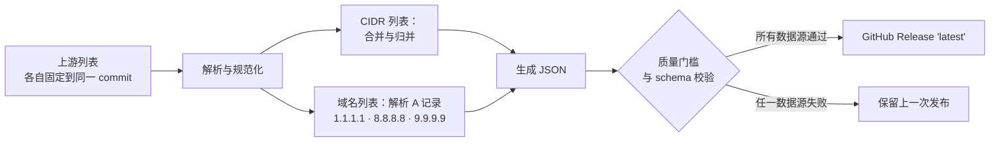

<div align="center">

# Amnezia 中国大陆分流列表

**自动更新的 [AmneziaVPN](https://amnezia.org) IPv4 分流列表：一份固定的中国大陆网段列表，一份持续刷新的“需要走 VPN 的域名”列表。**

由 GitHub Actions 每 6 小时刷新 · 以 GitHub Release 资产发布 · 无需自建服务器

[](https://github.com/shidevil/amnezia-china-split-tunnel/actions/workflows/build.yml)
[](https://github.com/shidevil/amnezia-china-split-tunnel/actions/workflows/ci.yml)
[](https://github.com/shidevil/amnezia-china-split-tunnel/releases/latest)
[](LICENSE)


[English](README.md) · **简体中文**

</div>

---

## 目录

- [项目简介](#项目简介)
- [快速开始](#快速开始)
- [可用列表](#可用列表)
- [输出格式](#输出格式)
- [工作原理](#工作原理)
- [配置](#配置)
- [自动化与发布](#自动化与发布)
- [查看失败报告与故障排查](#查看失败报告与故障排查)
- [部署你自己的副本](#部署你自己的副本)
- [本地开发](#本地开发)
- [项目结构](#项目结构)
- [局限性：使用前请先阅读](#局限性使用前请先阅读)
- [致谢](#致谢)
- [许可证](#许可证)

## 项目简介

AmneziaVPN 的分流功能路由的是 **IP 地址和子网**。它从不按域名匹配，也不会自行刷新列表（细节见[局限性](#局限性使用前请先阅读)）。因此，一份域名列表的质量，最多只相当于导入当天解析出的地址。

本项目正是围绕这一点设计的。它只发布**两种列表**，而你只需导入其中**一个**：

| | `cn-cidr.json`（固定） | `proxy.json`（持续更新） |
|---|---|---|
| **是什么** | IPv4 网段（CIDR），取自上游并合并 | 域名，以及 DNS 为每个域名返回的 IPv4 地址 |
| **内容** | 中国大陆网段，来自两份上游列表 | Loyalsoldier 的 GFW 与 proxy 域名列表 |
| **Amnezia 模式** | `Addresses from the list must not go through VPN`：中国大陆流量留在 VPN 之外 | `Only the sites listed here will be accessed through the VPN` |
| **在 App 内会过期吗？** | 几乎不会：地址分配变化很慢 | 会：DNS 应答会变，需要时不时重新导入 |

GitHub Actions 工作流每 6 小时执行一次：

1. 拉取上游列表，每个都固定到同一个上游 commit，
2. 解析并规范化规则，
3. 把 CIDR 列表**合并**为覆盖相同地址的最少网段，并通过公共 DNS 解析器**解析**每个域名的 IPv4 A 记录，
4. 生成 Amnezia 兼容的 JSON 文件，
5. 按严格的质量门槛进行校验，
6. 发布到唯一一个滚动更新的 GitHub Release，因此下载链接永不改变。只有内容发生变化的列表才会重新发布。

只要构建过程中出现任何问题（DNS 故障、上游文件为空或被截断、质量门槛未通过），构建就会失败，**上一次的发布保持不变**。如果上传本身失败，会先重试，仍失败则恢复旧资产（见[自动化与发布](#自动化与发布)）。

### 特性

- **全自动**：每 6 小时定时运行，也可手动触发；不依赖本地机器或服务器。
- **两份列表，用途不重叠**：一份不依赖 DNS 的固定列表，一份持续刷新的域名列表。
- **保留后缀规则**：`.example.com` 与 `example.com` 是不同的规则，输出中也保持区分。
- **设计上安全**：全部通过才发布、失败率门槛、每个上游的数量下限与合并后网段的规模上限、对写出的文件做 schema 校验，并且在 DNS 解析器不可达时快速中止。
- **只保留可用地址**：仅 IPv4；黑洞应答（`0.0.0.0`、`127.0.0.1`）、私有网段和短得离谱的前缀（短于 `/8`）都不会进入路由列表。
- **输出确定**：顺序稳定，数据未变化时生成完全相同的文件，不会产生无意义的 Release 更新。
- **配置驱动**：在 `config.yaml` 中新增、合并或停用数据源，无需改代码。
- **最小权限**：构建任务只读；只有发布任务可写；所有第三方 Action 都固定到 commit SHA。

## 快速开始

### 1. 下载

滚动发布使用 `latest` 标签。以下链接稳定不变，公开仓库无需认证：

| 列表 | 下载地址 |
|---|---|
| cn-cidr（固定） | <https://github.com/shidevil/amnezia-china-split-tunnel/releases/latest/download/cn-cidr.json> |
| proxy（持续更新） | <https://github.com/shidevil/amnezia-china-split-tunnel/releases/latest/download/proxy.json> |
| 构建元数据 | <https://github.com/shidevil/amnezia-china-split-tunnel/releases/latest/download/build-info.json> |

```bash
curl -fLO https://github.com/shidevil/amnezia-china-split-tunnel/releases/latest/download/cn-cidr.json
```

> **使用 fork？** 请把所有链接中的 `shidevil/amnezia-china-split-tunnel` 替换为 `<你的账号>/<你的仓库>`。固定到标签的形式
> `https://github.com/<owner>/<repo>/releases/download/latest/cn-cidr.json` 同样可用，并且始终指向名为 `latest` 的标签。

### 2. 导入 Amnezia

> 以下步骤基于 Amnezia 客户端的分流功能；不同版本和平台的菜单名称略有差异，并且本项目的输出**尚未在 App 内实际导入测试**（见[局限性](#局限性使用前请先阅读)）。

1. 将下载的 `.json` 文件复制到运行 AmneziaVPN 的设备。
2. 打开 **设置 → 分流（Split tunneling）→ 站点（Sites）**。
3. 选择与该列表相匹配的模式（见下表）。
4. 打开站点列表的“⋮”菜单，选择导入方式（`Replace site list` 或 `Add imported sites to existing ones`），再选择该 JSON 文件。刷新之前导入过的列表时，请选 `Replace site list`。
5. 启用站点分流，并重新连接 VPN。

不同列表对应的模式：

| 目标 | Amnezia 模式 | 列表 |
|---|---|---|
| 中国大陆流量留在 VPN **之外**，其余流量走 VPN | `Addresses from the list must not go through VPN` | `cn-cidr.json` |
| **仅**被封锁/境外站点走 VPN，其余全部直连 | `Only the sites listed here will be accessed through the VPN` | `proxy.json` |

**这两个文件是二选一，而不是一对。** App 同一时间只有一种模式生效，并且每种模式各自保存一份站点列表，所以两个都导入没有意义：在第一种模式下 `proxy.json` 会被忽略，在第二种模式下 `cn-cidr.json` 会被忽略。先用哪一个由你决定。`cn-cidr.json` 永远不需要刷新，但它使用的是 Amnezia 文档最不推荐的模式（文档把 `Addresses from the list must not go through VPN` 描述为适用于本地和运营商网络），而且有几千个条目，没有人在 App 内测试过。`proxy.json` 使用的是推荐的 `Only the sites listed here…` 模式，但会随着 DNS 应答的变化而过期。在依赖其中任何一个之前，请先在你的设备上试一试（见[局限性](#局限性使用前请先阅读)）。

## 可用列表

所有文件都使用 [Amnezia 导入格式](#输出格式)。上游文件通过 `raw.githubusercontent.com` 获取，并固定到构建时的当前 commit。

| 输出文件 | 类型 | 上游文件 | 内容 |
|---|---|---|---|
| `cn-cidr.json` | `cidr` | [mayaxcn/china-ip-list](https://github.com/mayaxcn/china-ip-list) 的 [`chnroute.txt`](https://raw.githubusercontent.com/mayaxcn/china-ip-list/master/chnroute.txt)，以及 [Xiaobei09/Rule-Provider](https://github.com/Xiaobei09/Rule-Provider) 的 [`CN.txt`](https://raw.githubusercontent.com/Xiaobei09/Rule-Provider/main/ruleset/geoip/QuantumultX/CN.txt) | 中国大陆 IPv4 网段。只要**任意一份**上游列出某个网段就保留（并集），然后合并。IPv6 行会被丢弃。 |
| `proxy.json` | `domains` | [Loyalsoldier/surge-rules](https://github.com/Loyalsoldier/surge-rules/tree/release) `release` 分支的 `gfw.txt` 与 `proxy.txt` | 需要走 VPN 的域名，合并并去重，每个域名附带其当前的 IPv4 地址 |
| `build-info.json` | 无 | 无 | 构建元数据：时间戳、上游 commit、各列表统计与哈希 |

关于并集：写作本文时，两份上游列表在约 96% 的地址空间上一致，并集额外加入了只有其中一份声称拥有的 3.8%（1360 万个地址）。其中 580 万个地址是 mayaxcn 的列表在前一周新增的，另一份列表并没有它们。选择并集是有意为之：它让更多中国大陆流量留在 VPN 之外。代价是，如果任一上游在这些网段上有误，发往这些网段的境外流量会绕过 VPN。如果你更想只保留两份列表都认同的部分，请提交 issue，或让 `config.yaml` 只指向一个 URL。

Loyalsoldier 的其他列表（`direct`、`reject`、`apple` 等）不再构建：把域名转成 IP 快照并不适合这个 App，而固定列表已经覆盖了中国大陆。你仍可以把其中任何一个加回 `config.yaml`（见[配置](#配置)）。

### 典型结果

2026-11-24 的完整构建实测结果（上游提交 `6eaf976`、`4f4feb1` 和 `964903e`；解析器 1.1.1.1、8.8.8.8 和 9.9.9.9）。构建是在开发者本机的 Docker 中运行的，**不是**在 GitHub runner 上。两个列表都通过了全部质量门槛。DNS 应答随时在变，请把这些数字当作量级参考，而不是承诺。

| 列表 | 规则数 | 条目数 | 结果 | 大小 |
|---|---:|---:|---|---:|
| `cn-cidr.json` | 7,305 | 6,793 | 359,175,656 个地址（占 IPv4 的 8.4%） | 486.1 kB |
| `proxy.json` | 27,407 | 22,485 | 解析成功率 82.0% | 3.0 MB |

CIDR 列表来自两份上游的 5,697 和 7,054 个 IPv4 网段，其中 5,446 个同时出现在两份文件中，剩下 7,305 个不同的网段，合并为 6,793 个 CIDR。有 2,982 行 IPv6 被跳过，没有无效行。在域名列表中，有 4,346 条规则同时出现在 `gfw.txt` 和 `proxy.txt` 中。

在没有生成条目的 4,922 条域名规则中，4,393 条没有 A 记录（1,485 条 NXDOMAIN，2,908 条空应答或仅有 IPv6），282 条返回 SERVFAIL，247 条超时，没有其他类型的失败。只有超时计入错误率门槛：0.90%，上限为 10%。22,485 个条目共包含 42,326 个地址，其中 21,015 个互不相同。

## 输出格式

每个文件都是 UTF-8 编码的 JSON 数组，格式即 Amnezia 导入所用格式。两种列表使用相同的三个键，顺序也相同。

### 域名条目

`proxy.json` 中每条成功解析的规则对应一个条目：

```json
[
  {
    "hostname": ".example.com",
    "ip": "93.184.216.34",
    "ips": [
      "93.184.216.34"
    ]
  },
  {
    "hostname": "baidu.com",
    "ip": "110.242.74.102",
    "ips": [
      "110.242.74.102",
      "111.63.65.103",
      "111.63.65.247",
      "124.237.177.164"
    ]
  }
]
```

| 字段 | 含义 |
|---|---|
| `hostname` | 原始规则，**转为小写，保留开头的点** |
| `ip` | `ips` 的第一个地址 |
| `ips` | 所有去重后的公网 IPv4 地址，按数值升序排列 |

条目按域名排序（排序时忽略开头的点），因此 DNS 数据未变时生成的文件字节完全一致。

### 后缀规则

Loyalsoldier 的文件包含两种规则，它们**含义不同**：

| 规则 | 含义 | 实际解析的名称 | 输出中的 `hostname` |
|---|---|---|---|
| `example.com` | 仅此主机 | `example.com` | `example.com` |
| `.example.com` | 此域名**及其所有子域名**（后缀匹配） | `example.com` | `.example.com` |

对于后缀规则，解析的是主域名（`example.com`），但 `hostname` 中保留开头的点。生成器**绝不猜测子域名**，也不会凭空编造 IP 地址；它只报告规则中那个名称在 DNS 里实际返回的结果。

没有可用 IPv4 记录的域名会被**排除**，而不是写成空的 `ips`；它们会列在失败报告中。

### CIDR 条目

`cn-cidr.json` 中每个网段对应一个条目，格式与 Amnezia 客户端导出手动添加的子网时的格式一致：网段写在 `hostname` 中，`ip` 与 `ips` 为空。

```json
[
  {
    "hostname": "1.0.1.0/24",
    "ip": "",
    "ips": []
  },
  {
    "hostname": "1.0.8.0/21",
    "ip": "",
    "ips": []
  }
]
```

条目按地址排序，相邻网段会被合并（`1.0.0.0/24` 与 `1.0.1.0/24` 合并为 `1.0.0.0/23`），被其他网段包含的网段会被去掉，所以该文件是恰好覆盖上游列表所列地址的最小 CIDR 集合。整个过程不做任何解析：导入什么，就路由什么。

## 工作原理



1. **拉取。** 对每个 GitHub 上的 URL，先把分支解析为 commit SHA，再以该 SHA 下载文件，因此 `build-info.json` 中记录的 `revision` 准确描述了读取的内容。（如果 GitHub API 查询失败，则改用分支 URL，此时 `revision` 为 `null`。）下载带退避重试；空响应、超大响应、被截断的响应（短于声明的 `Content-Length`）和非 UTF-8 响应都会被拒绝。
2. **解析。** 跳过注释和空行，完全重复的规则被去除，无效行会被报告而不是被悄悄忽略。**一个数据源的每个 URL 都必须贡献规则**：只提供垃圾内容的 URL 会让构建停止，而不是悄悄地从合并列表中消失。
   - *域名列表：* 规则转为小写并校验；IP 字面量、通配符、IDN 和格式错误的标签都视为无效。
   - *CIDR 列表：* 接受上游出现的三种写法（`1.0.1.0/24`、`ip-cidr, 1.0.1.0/24` 和 `IP-CIDR,1.0.1.0/24,DIRECT,no-resolve`）。IPv6 行（包括 QuantumultX 的 `ip6-cidr` 关键字）会被有意跳过并计数。无效行包括：主机位不为零的行、前缀短于 `/8` 的行、与任何私有或特殊用途网段有重叠的行，以及声明了 `DIRECT` 之外策略的行。列出的网段会绕过 VPN，所以 `IP-CIDR,8.8.8.0/24,PROXY` 绝不能出现在列表中，而包含 `0.0.0.0/0` 的列表会让所有流量绕过 VPN。
3. **解析 DNS（仅域名列表）。** 所有域名数据源中的不同名称只**统一解析一次**（见 [DNS 解析](#dns-解析)）。CIDR 列表从不接触 DNS。
4. **生成并校验。** 确定性地生成 JSON，并校验两次：写入前一次，写入后对实际文件再一次。
5. **判定。** 内容哈希与上次发布相同的列表不会重复上传（除非强制）。
6. **发布。** 由具有写权限的独立任务上传文件并校验。

### DNS 解析

仅适用于域名列表。

- 只查询 IPv4 **A 记录**，不查 AAAA。
- 起始解析器由域名的稳定哈希决定（负载分散到各解析器，且多次运行可复现）；每次重试换用下一个解析器。
- **会终止查询的结果：** 地址列表、`NXDOMAIN`、或空应答（`NODATA`）。其余情况（超时、`SERVFAIL`、`REFUSED`、网络错误）会重试，最多额外重试 `retries` 次。
- **会跟随应答中的 CNAME 链：** `www.shop.example → edge.cdn.example → pop7.cdn.example → A` 会得到最终的 A 记录。
- 非公网单播 IPv4（`0.0.0.0/8`、`10/8`、`100.64/10`、`127/8`、`169.254/16`、`172.16/12`、`192.168/16`、`198.18/15`、组播、保留段、文档段等）会被丢弃。网段表是显式列出的，因此结果不依赖 Python 版本。
- 并发有上限（固定数量的 worker），并设有全局每秒查询数（QPS）上限以保护公共解析器。
- 同一次构建中，同一个名称不会被查询两次，即使它出现在多条规则或多个列表中。
- 不做跨构建的 DNS 缓存：记录 TTL 远短于 6 小时的刷新间隔，缓存几乎不会命中，反而可能返回过期数据。

每条规则恰好得到下列结果之一：

| 结果 | 含义 | 是否计入错误率门槛 |
|---|---|---|
| `ok` | 至少有一个公网 IPv4 地址 | 否 |
| `nxdomain` | 域名不存在 | 否 |
| `nodata` | 域名存在，但没有（公网）A 记录 | 否 |
| `servfail` | 每次尝试都返回 SERVFAIL（通常是域名配置损坏） | 否 |
| `timeout` | 所有解析器均无应答 | **是** |
| `error` | 网络错误、REFUSED（解析器拒绝为我们服务）或其他意外应答 | **是** |

### 质量门槛

对每个数据源，违反以下任意一项，构建就会失败。两种类型的门槛不同，`config.yaml` 会拒绝另一种类型的选项。

**域名列表：**

| 门槛 | 默认值 | 作用 |
|---|---|---|
| `max_error_rate` | `0.10` | `(超时 + 错误) / 规则数`：检测解析器或网络故障 |
| `min_resolved_rate` | `0.30` | `已解析 / 规则数`：检测“所有应答都为空”的故障 |
| `allow_empty` | `false` | 解析后**零条目**的数据源会被拒绝 |
| JSON schema | 始终 | 字段精确、`ip == ips[0]`、唯一、有序、公网 IPv4、主机名有效且唯一 |

NXDOMAIN、空应答和 SERVFAIL 反映的是*域名*的状况而不是解析器的问题，因此有意不计入错误率门槛。

**CIDR 列表：**

| 门槛 | 默认值 | 作用 |
|---|---|---|
| `min_entries` | `1`（默认配置：`4000`） | **每个 URL** 以及合并后的列表都必须至少有这么多有效网段，避免被截断或损坏的上游悄悄地从并集中消失 |
| `max_addresses` | 无（默认配置：`400000000`） | 拒绝覆盖地址数超过该值的列表：对绕过 VPN 的列表来说，上游声称得太多才是危险的故障 |
| JSON schema | 始终 | 字段精确、`ip` 与 `ips` 为空、规范的公网 IPv4 网段、前缀不短于 `/8`、有序、无重叠 |

发布是**全有或全无**：只要任一被选中的数据源未通过，就不会上传任何内容，上一次发布保持不变。阈值可按数据源单独覆盖（见下文）。

**故障时快速失败。** 如果已完成至少 500 次查询，其中超过 90% 超时或出错，说明 runner 上没有任何解析器在应答。构建会立即停止（退出码 1，不发布任何内容），而不是花几个小时去重试剩下的所有名称。网络只是变差（被限流、一批失效域名集中出现）时不会中止，由运行结束后按数据源计算的错误率门槛来判定。

## 配置

所有设置都在 [`config.yaml`](config.yaml) 中。

### 启用或停用数据源

```yaml
sources:
  proxy:
    enabled: false        # 跳过该列表
    url:
      - https://raw.githubusercontent.com/Loyalsoldier/surge-rules/release/gfw.txt
      - https://raw.githubusercontent.com/Loyalsoldier/surge-rules/release/proxy.txt
```

停用某个数据源后，它不再更新，并会在下一次发布时从 `build-info.json` 中消失（仅停用不会改变任何列表，因此不会触发发布；如需立即生效，请带 `force` 运行工作流），但它在 Release 上的旧资产会保留，直到你自己删除（例如 `gh release delete-asset latest proxy.json`）。从文件中删除某个数据源时同理。

### 新增数据源

添加一个条目即可，无需改代码。键名即输出文件名（`my-list` → `my-list.json`），只能包含 `a-z`、`0-9`、`_` 和 `-`。名称 `build-info` 和 `all` 为保留名称。

```yaml
sources:
  my-domains:
    url: https://example.com/path/to/domains.txt   # 每行一条普通规则或 ".后缀" 规则
    min_resolved_rate: 0.2                         # 可选：按数据源覆盖阈值

  my-networks:
    kind: cidr                                     # IPv4 网段，而不是域名
    url:                                           # 多个 URL 会合并成一个列表
      - https://example.com/a/chnroute.txt
      - https://example.com/b/CN.txt
    min_entries: 1000                              # 每个 URL 以及合并后的列表
    max_addresses: 500000000                       # 可选的规模上限
```

- `kind` 取 `domains`（默认）或 `cidr`。`max_error_rate`、`min_resolved_rate` 和 `allow_empty` 属于 `domains`，`min_entries` 和 `max_addresses` 属于 `cidr`；加载器会拒绝错误的组合。
- `url` 可以是一个 URL，也可以是一个列表。请使用文件的 `raw.githubusercontent.com` 地址，而不是 `github.com/…/blob/…` 页面：页面是 HTML，而且只有 raw 地址才能固定到 commit。
- 域名列表采用 Loyalsoldier 使用的 Surge domain-set 格式：每行一个 `host` 或 `.suffix`，允许以 `#`、`;` 或 `//` 开头的注释行。CIDR 列表接受[工作原理](#工作原理)中描述的三种写法。
- 如需恢复 Loyalsoldier 的其他列表，把它作为域名数据源加入并填写其 URL，例如 `.../release/direct.txt`。请留意体积：见[局限性](#局限性使用前请先阅读)。

> **YAML 陷阱：** 未加引号的 `off`、`on`、`yes`、`no` 和纯数字在 YAML 1.1 中不是字符串。请给这类名称加引号（`"off":`）；否则加载器会给出明确的错误提示。

### DNS、拉取与阈值

```yaml
dns:
  resolvers: [1.1.1.1, 8.8.8.8, 9.9.9.9]   # 任意数量的解析器 IP
  timeout: 5          # 每次尝试的超时秒数
  retries: 2          # 首次之后的额外尝试次数，每次换下一个解析器
  concurrency: 100    # 同时进行的查询数
  max_qps: 300        # 全局查询速率上限（0 表示不限制）

fetch:
  timeout: 30
  retries: 3
  max_bytes: 67108864

validation:           # 所有域名数据源的默认值
  max_error_rate: 0.10
  min_resolved_rate: 0.30
  allow_empty: false
```

未知的键会被拒绝，因此像 `enabeld: false` 这样的拼写错误不会悄悄导致数据源保持启用。

## 自动化与发布

| | |
|---|---|
| **定时** | `0 */6 * * *`（**UTC** 时间 00:00、06:00、12:00、18:00）。GitHub 在负载高时可能延迟定时任务，请把 6 小时视为刷新间隔而非保证。 |
| **手动运行** | *Actions → Build Amnezia lists → Run workflow* |
| **手动参数** | `source`：`all` 或逗号分隔的列表，如 `cn-cidr,proxy`（单数据源构建需要已存在的发布，请先完整构建一次）；`force`：即使没有变化也发布 |
| **发布** | 唯一一个滚动更新的 Release，标签为 `latest`。每次构建成功后就地替换资产，并且只替换内容有变化的资产。 |
| **耗时** | 在上面的构建中，解析 `proxy.json` 的 27,402 个不同名称用了约 6 分钟（约每秒 76 个名称），整次运行共 6 分 14 秒。**尚未**在 GitHub 托管的 runner 上测量过。`max_qps: 300`（每秒最多 300 次查询）的上限意味着最快也要约 1.5 分钟，任务时限为 4 小时。只构建 `cn-cidr` 时完全不做 DNS 解析。 |

工作流包含三个任务：

| 任务 | 权限 | 作用 |
|---|---|---|
| `build` | `contents: read` | 拉取、解析、生成、校验；将结果作为工作流 artifact 上传 |
| `publish` | `contents: write` | 仅在 `build` 产生变化时运行；先备份当前资产，再上传各列表、最后上传 `build-info.json`（带重试），若所有尝试都失败则恢复备份，最后校验大小 |
| `keepalive` | `actions: write` | 尽力而为地重新启用定时（见下文）；绝不会导致运行失败 |

每次运行都会在任务摘要页写入摘要（各列表统计、失败情况），并把 `reports/`（失败列表）作为构建 artifact 上传。

**发布失败时。** 发布任务会先备份当前资产（备份失败则直接停止），然后上传变化的列表，最后才上传 `build-info.json`，最多重试三次。由于在所有列表到位之前旧的 `build-info.json` 一直保留，中途失败的运行不会让下一次运行误以为过期的列表是最新的。如果所有尝试都失败，会从备份中恢复本次运行替换过的资产（同样带重试）并把运行标记为失败；本次运行没有碰过的资产保持原样。`gh release upload --clobber` 会先删除旧资产再上传新资产，因此在这个间隙内下载可能暂时遇到文件缺失或旧文件；如果恢复也失败，运行会明确报错，下一次成功的构建会重新发布受影响的列表（它们的内容哈希会与旧的 `build-info.json` 不同；如果某个列表恰好与旧版相同，请带 `force` 运行工作流）。

**单数据源与无变化的构建。** 以 `source=proxy` 手动运行只会重建 `proxy.json`，并把它的记录合并进现有的 `build-info.json`，其他列表及其元数据保持原样。生成内容与上次发布字节完全相同的列表不会被重复上传；对 `cn-cidr.json` 来说，大多数运行都是如此。

**GitHub 可能停用定时工作流。** 在公开仓库中，如果 60 天没有仓库活动，GitHub 会停用定时工作流。由于本项目从不向仓库提交内容，`keepalive` 任务会在每次定时运行时重新启用该工作流。这是尽力而为的措施，其对 GitHub 不活跃计时器的实际效果没有保证；如果定时被停用，任意一次 push 或手动运行即可恢复。

### `build-info.json`

```json
{
  "generator_version": "1.0.0",
  "generated_at": "2026-11-24T06:00:00Z",
  "upstream": [{"repository": "mayaxcn/china-ip-list", "branch": "master", "revision": "<commit sha>"}],
  "dns": {"resolvers": ["1.1.1.1", "8.8.8.8", "9.9.9.9"], "unique_queries": 27402},
  "totals": {"domains_processed": 0, "domains_resolved": 0, "domains_failed": 0, "...": 0},
  "sources": {
    "cn-cidr": {
      "file": "cn-cidr.json", "kind": "cidr", "entries": 0, "addresses": 0, "output_sha256": "...",
      "upstreams": [{"url": "...", "revision": "<commit sha>", "sha256": "...", "rules": 0}],
      "...": 0
    }
  }
}
```

`totals` 只统计域名列表：网段不算“已处理的域名”。`dns.unique_queries` 统计的是**本次运行**中解析的不同名称数量。因此单数据源构建之后，它只描述那一次运行，而其他数据源保留它们之前的记录。

## 查看失败报告与故障排查

**失败报告。** 每次构建都会为每个域名列表写入 `reports/<source>-failures.txt`，每行对应一条没有产生条目的规则。（CIDR 列表没有失败报告：它不做任何解析。被拒绝的行，例如私有网段，会记录在构建日志中：每个数据源记录前五行，再加一个总数。）

```text
# proxy: 22485 of 27407 rules resolved to a public IPv4 address
# nxdomain=... nodata=... servfail=... timeout=... error=... invalid-lines=...
# columns: status<TAB>rule<TAB>detail
timeout	.slow.example.cn	timeout from 8.8.8.8
nxdomain	.gone.example	
```

可在运行页面下载：*Actions → 对应的运行 → Artifacts → `build-reports`*。

| 现象 | 可能原因与处理 |
|---|---|
| 构建失败，提示 `error rate … exceeds the … limit` | 解析器不可达或被限流。重新运行；若持续出现，降低 `dns.concurrency` / `dns.max_qps`，提高 `dns.timeout` / `dns.retries`，或更换 `dns.resolvers`。 |
| `resolved rate … is below the … minimum` | 几乎所有应答都为空。检查解析器和 `reports/*-failures.txt`；对本来就解析率低的列表，可单独设置 `min_resolved_rate`。 |
| `resolvers unreachable: … lookups timed out or failed` | runner 无法访问所配置的任何解析器，构建提前停止，没有发布任何内容。稍后重试，或把 `dns.resolvers` 改为 GitHub 网络可达的解析器。 |
| `… has only N valid IPv4 CIDRs (minimum M)` | 该上游为空、被截断或改了格式，因此不被允许从并集中消失。打开消息中指出的 URL 检查。如果上游确实缩小了，再降低 `min_entries`。 |
| `only N merged CIDRs (minimum M)` | 虽然每个上游都通过了检查，合并后的列表仍然太小。降低 `min_entries` 之前，请先检查上游的改动。 |
| `entry …: prefix is shorter than /8` | 两个相邻的上游网段（例如 `6.0.0.0/8` 和 `7.0.0.0/8`）合并成了比本工具愿意让其绕过 VPN 的上限更大的块。构建会失败并保留上一次发布；改动任何设置之前，请先查看上游的变化。 |
| `the list covers … addresses, over the … limit` | 某个上游列表增长到远超中国大陆的实际规模，或混入了错误的网段。提高 `max_addresses` 之前，请先检查上游的改动。 |
| `source '…': … has no valid IPv4 CIDRs` | 该 URL 返回的不是 CIDR 列表（例如 HTML 页面，常见于 `github.com/…/blob/…` 链接）。请改用 raw 地址。 |
| `no usable previous build-info.json to merge into` | 手动的单数据源运行会合并进现有发布的 `build-info.json`，而它缺失、已损坏或下载失败。请先以 `source=all` 运行一次工作流（若只是下载失败，重新运行即可）。 |
| `no domains resolved … refusing to publish empty output` | 条目为零。仅当确实预期输出为空时（例如一份纯顶级域名列表），才对该数据源设置 `allow_empty: true`。 |
| `source '…' has no valid rules` | 上游的域名文件为空或格式不同。打开配置中的 URL 检查。 |
| `GET … failed` | 网络或上游问题；拉取器已经重试过。稍后重新运行。 |
| 预期的域名不在输出中 | 在 `<source>-failures.txt` 中查找。`nodata` 通常表示该名称本身没有 A 记录（对没有主域名记录的后缀规则和顶级域名很常见）。 |
| 大量 `servfail` | 大型列表中的失效域名很常见；它们不会触发错误率门槛。 |
| 定时运行不再出现 | 见上文关于 60 天的说明；手动触发一次 *Run workflow*。 |

手动测试某个解析器：`dig @1.1.1.1 +short A example.com`。

## 部署你自己的副本

**前提：** 一个 GitHub 账号和 `git`。无需服务器、API 密钥或 secret。

1. **创建**一个空仓库（公开最省事，匿名下载链接和不限量的 Actions 分钟数都需要公开仓库）。
2. **推送**本项目（以下命令使用本项目的仓库地址；fork 时请换成你自己的）：

   ```bash
   git init
   git add -A
   git commit -m "Initial commit"
   git remote add origin git@github.com:shidevil/amnezia-china-split-tunnel.git
   git branch -M main
   git push -u origin main
   ```

3. **启用 Actions。** 打开 *Actions* 标签页；如果 GitHub 询问，点击 *"I understand my workflows, go ahead and enable them"*（fork 的仓库默认停用工作流）。
4. **检查令牌权限。** 工作流自行声明了所需权限，因此默认设置即可。如果你的组织强制只读上限，请设置 *Settings → Actions → General → Workflow permissions → Read and write permissions*。
5. **先运行一次。** *Actions → Build Amnezia lists → Run workflow*（保持默认值）。这会创建 `latest` 发布；之后由定时任务接管。定时任务只会在默认分支上触发。
6. **使用链接：** 替换所有者和仓库名后，使用[快速开始](#快速开始)中的链接。

## 本地开发

```bash
python3.12 -m venv .venv && source .venv/bin/activate
pip install -r requirements-dev.txt

pytest                     # 单元测试与端到端测试（模拟 DNS，无需网络）
ruff check . && ruff format --check .
RUN_LIVE_DNS=1 pytest tests/test_live_integration.py   # 可选：真实 DNS

python -m src.main --help
python -m src.main --source cn-cidr --out-dir dist --reports-dir reports   # 真实构建固定列表（不做 DNS 解析）
```

命令行选项：`--config`、`--source`（`all` 或逗号分隔）、`--force`、`--out-dir`、`--reports-dir`、`--previous-build-info`、`--require-previous`（除非该文件可用否则失败；工作流在单数据源构建时会设置它）、`-v`。
退出码：`0` 成功（包括“无变化”），`1` 质量门槛或校验失败，`2` 配置、下载或解析问题，`130` 被中断。失败时不会向 `--out-dir` 写入任何文件。

数据源的 `url` 也可以是 `file://` URL，测试套件就是这样用本地样例构建的。

## 项目结构

```text
.
├── .github/workflows/
│   ├── build.yml         # 定时 + 手动：构建、发布、keepalive
│   └── ci.yml            # push / pull request 时运行 lint 与测试
├── config.yaml           # 数据源、DNS 设置、质量门槛
├── src/
│   ├── config.py         # 加载并严格校验 config.yaml
│   ├── fetcher.py        # 带重试的 HTTP、上游 commit 固定
│   ├── parser.py         # domain-set 与 CIDR 列表解析、校验
│   ├── resolver.py       # 异步 A 记录解析（dnspython）
│   ├── generator.py      # 条目、CIDR 合并、统计、确定性 JSON
│   ├── validator.py      # schema 与质量门槛检查
│   ├── reporter.py       # 失败报告、build-info、发布说明、摘要
│   └── main.py           # 编排与命令行
├── tests/                # 单元、端到端与工作流守卫测试
├── reports/              # 构建报告（生成物，不提交）
├── requirements.txt      # dnspython, PyYAML
└── requirements-dev.txt  # + pytest, ruff
```

## 局限性：使用前请先阅读

### Amnezia 客户端如何处理这些文件

以下内容读自客户端源代码（[amnezia-client](https://github.com/amnezia-vpn/amnezia-client)，5.x）及其[分流文档](https://docs.amnezia.org/documentation/instructions/vpn-split-tunneling)。**这一切都没有在 App 内端到端测试过。**

- **只有 IP 地址和子网会被路由。** 主机名从不与流量匹配。对于域名条目，只有存放在 `ips` 中的地址有效；对于 CIDR 条目，则是网段本身。
- **导入时不做解析，且只读取一次文件。** 没有发现订阅 URL 的方式，所以刷新列表就意味着手动导入新文件。文档对域名也是这么说的：App 保存它手上的地址，并且不会自动更新。
- **桌面客户端每次连接时会重新解析已保存的主机名**，并且只增加地址：旧地址不会被移除。在移动端客户端中没有发现类似机制，连接期间也不会刷新。以点开头的条目（后缀规则）是否会被重新解析，目前不清楚。
- **同一时间只有一种模式生效**，每种模式各有自己保存的列表（见[快速开始](#快速开始)）。
- **文档并不倾向于 `cn-cidr.json` 所用的模式。** 文档称 `Only the sites listed here will be accessed through the VPN` 是 Windows、iOS、macOS 和 Linux 上最有效且推荐的方法，而 `Addresses from the list must not go through VPN` 只推荐用于本地和运营商网络。把一份国家规模的列表导入第二种模式，是本项目自己的设计，而不是 Amnezia 文档中描述的用法。
- **每个地址和子网都会变成一条路由。** 客户端和操作系统能承受多少条，目前不清楚。`cn-cidr.json` 有几千个条目；在依赖它之前，请先在你的设备上试一试。

### 固定列表（`cn-cidr.json`）

- **它依据的是注册信息，而不是地理位置。** 上游列表来源于 APNIC 注册数据（以及 BGP 数据），它说明的是地址块分配给了谁，而不是服务器实际在哪里。在中国大陆注册、却被境外主机使用的网段，以及在境外注册、却在中国大陆使用的网段，都会被误判。上游项目自己也这么说。
- **它是并集。** 只被两份上游中的一份列出的网段也会被包含（见[可用列表](#可用列表)）。
- **“固定”指变化缓慢，而不是一成不变。** 该文件每 6 小时重建一次，仅在内容变化时才重新发布。2026-11-24 根据上游 commit 历史测得：合并后的列表在之前 24 小时内没有变化；在之前 7 天内增长了 1.6%（580 万个地址，没有任何移除），全部来自 mayaxcn 的列表（另一份列表那一周没有变化）；而在此之前的 23 天里变化约 0.007%（新增或移除了大约 23,000 个地址）。一个月的历史不足以确定一个变化速率，但每隔几个月重新导入一次看起来已经够用：错过一次更新，只意味着少数新网段仍然走 VPN。
- **仅 IPv4。** 客户端只路由 IPv4，所以 IPv6 行会被丢弃。

### 更新列表（`proxy.json`）

该文件是 **DNS 应答的 IP 快照**，而不是实时的域名匹配系统。

- **地域与解析器依赖。** 同一个域名在不同解析器、不同查询位置、不同时间可能解析到不同地址。这份列表反映的是 GitHub runner 通过所配置的公共解析器看到的结果。
- **CDN 地址是共享的。** 今天承载某个站点的 IP，也可能同时承载其他无关站点；按 IP 路由可能误伤（或漏掉）其他服务。
- **后缀规则只是近似。** `.example.com` 的含义是“该域名及所有子域名”，但只解析了主域名 `example.com`。位于不同 IP 上的子域名**不会**被发现，生成器也不会去猜。
- **两次构建之间 DNS 会变化，而 App 不会跟随。** 6 小时的定时只是刷新间隔，不保证变化会立即体现，而且文件变了也要你重新导入才有用。
- **部分域名没有 A 记录。** NXDOMAIN、空应答和仅有 IPv6 的主机会被排除。纯顶级域名规则则根本无法用 IP 表达。
- **列表很大。** 如果你加入 Loyalsoldier 的大型列表（`reject` 约 200,000 条规则，`direct` 约 110,000 条），文件会变得非常大，客户端处理它们可能很慢，甚至无法导入。
- **IDN 与非 DNS 规则。** 非 ASCII 名称、通配符和 IP 字面量会作为无效行被报告并跳过（当前 Loyalsoldier 列表中没有这类规则）。
- **解析器封锁。** 如果公共解析器对共享的 GitHub runner IP 限流，构建可能触发错误率门槛。这是有意为之：宁可保留上一次发布，也不发布不完整的结果。快速失败只能识别“一开始就不通”的网络；如果解析器在运行中途才停止应答，运行不会被提前终止，而是会跑完（或达到 4 小时的任务时限），然后失败且不发布任何内容。代价只是浪费 runner 时间，不会产生错误的发布。

## 致谢

本项目建立在优秀的开源工作之上，在此诚挚感谢：

- [**mayaxcn/china-ip-list**](https://github.com/mayaxcn/china-ip-list)：每小时更新的中国大陆 IPv4 列表，是 `cn-cidr.json` 的一半来源。
- [**Xiaobei09/Rule-Provider**](https://github.com/Xiaobei09/Rule-Provider)：QuantumultX 的 `CN.txt` 列表，是另一半来源。
- [**APNIC**](https://www.apnic.net/)：上述两份列表所依据的公开注册数据。
- [**Loyalsoldier/surge-rules**](https://github.com/Loyalsoldier/surge-rules)：`proxy.json` 背后持续维护的域名规则集。域名列表的一切都源于他们的规则。
- [**Loyalsoldier/v2ray-rules-dat**](https://github.com/Loyalsoldier/v2ray-rules-dat) 与 [**v2fly/domain-list-community**](https://github.com/v2fly/domain-list-community)：据 surge-rules 的 README，它们是其规则集的主要数据来源。
- [**felixonmars/dnsmasq-china-list**](https://github.com/felixonmars/dnsmasq-china-list)：据 surge-rules 的 README，Apple 与 Google 列表中部分域名来源于此。
- [**17mon/china_ip_list**](https://github.com/17mon/china_ip_list)：surge-rules 的 IP 规则集所使用的中国大陆 IPv4 数据。
- [**Loyalsoldier/geoip**](https://github.com/Loyalsoldier/geoip)：surge-rules 的致谢名单中列出的项目。

最后两项服务于 surge-rules 基于 IP 的规则集，而不是本项目所转换的列表；在此致谢是因为上游项目同样致谢了它们。

同时感谢 [AmneziaVPN](https://github.com/amnezia-vpn) 团队，以及 [dnspython](https://github.com/rthalley/dnspython) 和 [PyYAML](https://github.com/yaml/pyyaml) 的作者。

## 许可证

本仓库的源代码以 [MIT 许可证](LICENSE) 发布。

生成的列表派生自其他项目的数据。`cn-cidr.json` 派生自 [mayaxcn/china-ip-list](https://github.com/mayaxcn/china-ip-list) 与 [Xiaobei09/Rule-Provider](https://github.com/Xiaobei09/Rule-Provider)（两者均采用 MIT 许可证，基于 APNIC 公开注册数据，后者还使用了 IPtoASN 数据）。`proxy.json` 派生自采用 **GPL-3.0** 许可的 [Loyalsoldier/surge-rules](https://github.com/Loyalsoldier/surge-rules)，以及它所依赖的各项目。如需再分发生成的文件，请先查阅上游许可证。
